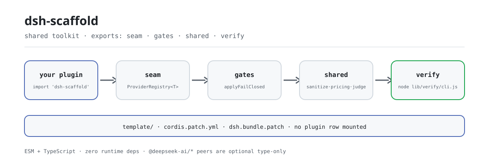

<div align="center">

<picture>
  <source media="(prefers-color-scheme: dark)" srcset="docs/assets/dsh-scaffold-flow-dark.svg">
  
</picture>

# dsh-scaffold

**Fold the Provider seam, the approval gate, and sanitize/pricing/judge that every DSH plugin re-writes into one zero-dependency package.**

A shared toolkit for the PerryLink DSH plugin repositories: a pluggable Provider seam, fail-closed approval and adaptive session-event gates, mechanical verify scripts, shared pure modules, and a new-plugin skeleton.

[Install](#three-step-setup) · [Configuration](#configuration) · [FAQ](#faq) · [简体中文](README.md) · [English](README.en.md) · [Español](README.es.md) · [Português](README.pt.md) · [हिन्दी](README.hi.md)

[](LICENSE)
[](#compatibility)
[](https://www.npmjs.com/package/dsh-scaffold)
[](https://github.com/PerryLink/dsh-scaffold/actions/workflows/ci.yml)
[](#compatibility)

[](https://github.com/PerryLink/dsh-scaffold/stargazers)
[](https://www.npmjs.com/package/dsh-scaffold)
[](https://dshfind.com/plugins/PerryLink/dsh-scaffold?ref=badge)
[](https://securityscorecards.dev/viewer/?uri=github.com/PerryLink/dsh-scaffold)
[](https://dsh.market/)

```sh
dsh plugin --profile <name> add dsh-scaffold
```

</div>

<sub>Community tool, not affiliated with DeepSeek. Not a certification, security audit, or official endorsement: the `dsh.standards` block is a `not-run` placeholder, not a pass. Canonical repository: <https://github.com/PerryLink/dsh-scaffold>.</sub>

## What it is

A per-project audit of 20+ plugins found every repository hand-rolling the same Provider seam and re-copying the same sanitize, pricing, and verdict shapes. `dsh-scaffold` extracts all of it into one **ESM + TypeScript, zero-runtime-dependency** library: the pluggable Provider seam, the fail-closed approval gate and the adaptive session-event gate, the mechanical verify scripts, the shared sanitize/pricing/judge pure modules, and a new-plugin skeleton.

It is a library, not a plugin: it mounts no plugin row, registers no command or tool, starts no I/O of its own, and has no browser half; all a consumer takes is an import.

> **Name and package name.** This project used to be `@perrylink/dsh-plugin-kit` and is now **`dsh-scaffold`**; the old repo is a pointer/backup only. The npm publish name is `dsh-scaffold`; the bare name `dsh-scaffold` belongs to a different, unrelated project — installing it does not install this package.

```text
consuming plugin ──import──▶ seam · gates · shared · verify
                                   │
                                   └── template/ skeleton + cordis.patch.yml (intentionally empty: no rows)
```

## Three-step setup

1. **Install** (pick the one that fits):

   ```sh
   # library use: npm channel
   pnpm add dsh-scaffold

   # library use: git channel (prepare builds lib/ from production deps only)
   pnpm add github:PerryLink/dsh-scaffold

   # profile channel: let a profile mount it through the harness bundle channel
   dsh plugin --profile web add dsh-scaffold
   dsh plugin --profile web add github:PerryLink/dsh-scaffold
   ```

2. **Replace a hand-rolled registry**:

   ```ts
   import { ProviderRegistry } from 'dsh-scaffold/seam'

   const registry = new ProviderRegistry<Detector>({
     default: { name: 'regex', impl: new RegexDetector() },
   })
   ctx.effect(() => registry.register('ner', new NerDetector()))
   const active = registry.use('ner') ?? registry.use()
   ```

3. **Run the mechanical gates** (a non-zero exit means failure):

   ```sh
   pnpm run build
   node lib/verify/cli.js all .
   ```

**Uninstall**: `pnpm remove dsh-scaffold` (or delete the row from your profile patch). Nothing registers global state: uninstall is exactly the reverse of install.

## Core capabilities

`dsh-scaffold` turns the layers every DSH plugin repository re-writes into pure functions and thin gates; at runtime it imports nothing from `@deepseek-ai/*` and adds no dependencies:

- **Provider seam** — `ProviderRegistry<T>`: named registration, reversible (registering is a Cordis effect), and loud on duplicate names instead of silently overwriting.
- **Fail-closed approval gate** — `applyFailClosed`: approval never defaults to a grant; the only grant path is an explicit `allow-once`, and `deny` maps to `rejected`.
- **Adaptive session-event gate** — `maybeAppendSessionEvent` appends only when the host records the event type or the envelope can be stamped; a refused append is skipped, never retried in a way that could break session resume.
- **Shared pure modules** — sanitize, pricing, and judge in `shared` carry the same names and shapes as `dsh-mask` / `dsh-budget` / `dsh-auto-review`, so migration is mechanical.
- **Mechanical gates and a skeleton** — the `verify` subpath ships a `VerifyReport` plus a non-zero-exit CLI; `template/` is a three-role new-plugin skeleton (Service Definition / Provider / Consumer).

### Tools & surfaces

| Subpath | Purpose |
|---|---|
| `seam` | `ProviderRegistry<T>` — reversible, fail-loud named provider registry. |
| `gates` | `applyFailClosed`; `makeEventGate` / `maybeAppendSessionEvent` / `probeIgnorableAppend`. |
| `shared` | `sanitize` (`Stripper`, `redactText`, `redactMapping`, `sanitizeText`, `sanitizeUrl`), `pricing` (`BUILTIN_PRICES`, `estimateUsageCost`, `tokenCarbon`, `latencyStats`, `formatMoney`, `formatTokens`), `judge` (`parseVerdict`, `VERDICT_SCHEMA`, `riskExceeds`). |
| `verify` | Mechanical CI gates (`verify-license`, `verify-readme-languages`, `verify-seam`) returning a `VerifyReport`, with a non-zero-exit CLI: `node lib/verify/cli.js all .` |
| `template/` | New-plugin skeleton (`cordis.yml`, three-role plugin, test, README, `renovate.json5`). |
| root barrel | Re-exports all of the above. |

### Examples

These are the library's real entry points; install once, then call one.

**Detailed example** — command:

```sh
import { createStripper } from 'dsh-scaffold/shared'
createStripper().strip('call 13800138000 or email a@b.com')
```

Output:

```text
call <PHONE_1> or email <EMAIL_1>
```

*Observed from `README.md:153 (shared sanitize); src/shared/sanitize.ts:268; test/sanitize.test.ts:8-19`*

**Failure branch** — input:

```text
const r = new ProviderRegistry(); r.register('openai', impl); r.register('openai', impl)  // second call
```

Output:

```text
Error: Provider "openai" is already registered
```

*Observed from `plugins/dsh-scaffold/lib/seam/provider.js:55-58; plugins/dsh-scaffold/test/seam.test.ts:27-30; plugins/dsh-scaffold/README.md:164`*

**Brief examples**: `applyFailClosed` · `parseVerdict`

## Configuration

No runtime configuration: the gates and helpers are pure functions — no `Config` fields, no overridable defaults. The only configuration surface is the bundle-patch layer shipped as `cordis.patch.yml`: an intentionally empty array for harness profile composition, and the canonical place where consuming plugins add their own row. This package mounts no row.

Most-used keys (used by a consuming plugin in its own profile-patch row):

| Key | Default | Meaning |
|---|---|---|
| `insert` | `[]` | The patch layer's row array; intentionally empty here — no plugin row is mounted |
| `id` | — | The consuming plugin row's identifier (appears only in that plugin's patch) |
| `name` | — | The consuming plugin row's package name |
| `config` | `{}` | The consuming plugin row's config object |
| `disabled` | `false` | The consuming plugin row's switch |

<details>
<summary>Full table (6 keys)</summary>

| Key | Default | Meaning |
|---|---|---|
| `dsh.bundle.patch` | `./cordis.patch.yml` | The bundle-patch entry declared in package.json; the harness bundle channel reads it to recognize this package |
| `insert` | `[]` | The patch layer's row array; intentionally empty here — no plugin row is mounted |
| `id` | — | The consuming plugin row's identifier (appears only in that plugin's patch) |
| `name` | — | The consuming plugin row's package name |
| `config` | `{}` | The consuming plugin row's config object |
| `disabled` | `false` | The consuming plugin row's switch |

</details>

A consuming plugin's patch row looks exactly like this (`cordis.patch.yml` comments each key):

```yaml
insert:
  - id: my-plugin
    name: my-plugin
    config: {}
    # disabled: false
```

## FAQ

<details>
<summary>Will it drag dependencies into my plugin?</summary>

No. `dependencies` is an empty object, so there are zero runtime dependencies; `@deepseek-ai/cordis`, `@deepseek-ai/schemastery`, and the `@deepseek-ai/dsh-*` packages are all **optional** peers (`peerDependenciesMeta` marks each `optional: true`) used for type interop only — whether they are installed is your dependency tree's decision. `pnpm run verify:self-contained` is the gate that holds this line.

</details>

<details>
<summary>Is it a plugin or a library — and why can `dsh plugin add` install it?</summary>

A library. The package carries a `dsh.bundle.patch` layer (`cordis.patch.yml`), and that is an intentionally empty array: mounting it through the bundle channel adds no plugin row, it only lets this package resolve alongside a profile; uninstalling removes it, with no global state left behind.

</details>

<details>
<summary>If the host does not record my session event type, do audits get dropped silently?</summary>

The append is skipped, but not silently: `maybeAppendSessionEvent` appends only when the host records the type or the envelope can be stamped, and a refused append is skipped outright — never retried in a way that could break session resume (fail closed). `probeIgnorableAppend` probes first; a throwing probe is treated as `false`.

</details>

<details>
<summary>Does the approval gate ever default to a grant?</summary>

No. The default is `rejected`; the only grant path is an explicit `allow-once`. `deny` maps to `rejected`, and `'delegate'` has no verdict equivalent, so it resolves to `deny` while `EffectiveDecision.policy` keeps `'delegate'`.

</details>

<details>
<summary>Is there a browser half? Can I use it directly in a client?</summary>

There is no browser UI half. The pure core (`seam`, `gates`, `shared`) is browser-safe, but the package as a whole is a library consumed by the Host (and optionally Client) halves of other plugins, and ships no interface.

</details>

## Security boundaries

- `sanitize`/`redact*` are **display hygiene**, not a security boundary: they reduce leakage into logs and results, but they do not authenticate or authorize.
- Approval gates fail closed by default (`rejected`); the only grant path is an explicit `allow-once` opt-in.
- Session-event appends the host refuses are skipped, never retried in a way that could break session resume.
- Report vulnerabilities via GitHub Security Advisories — see `SECURITY.md`.

## Permissions & data

The kit performs no I/O, no network access, and no subprocess spawns on its own. `Stripper` keeps placeholder→original mappings in memory only, and `stats()`/`redactMapping()` never emit plaintext; a consumer that persists a mapping owns that decision and the storage permissions that come with it.

## Known limitations

- Hosts whose `Session.append` third argument is a `SurfaceIntent` (`0.1.2-rc.1`) throw `validateNext` on the ignorable-envelope probe; the gate degrades to skip-unknown, so audit events are dropped (fail closed) rather than logged on those hosts.
- `0.1.2-rc.1` (adapted 2026-09-02): the session envelope keeps its ignorable field for stored-log read compatibility only — `Session.append` still cannot stamp it, so audit-gate behavior is unchanged.
- The kit ships no browser UI half; it is a library consumed by the Host (and optionally Client) halves of other plugins.

## Interoperability with other DSH plugins

This package is a library rather than a plugin, so its footprint on other plugins is "zero registration" — every point below follows directly from the package manifest and this repo's sources, no probing required:

- **No plugin row.** `cordis.patch.yml` is an intentionally empty array: even through the bundle channel, no plugin row appears.
- **No service key.** There is no `ctx.provide()`, so no service key can collide.
- **No command, tool, client slot, or `webServer` prefix.** Those surfaces stay entirely with the consuming plugin.
- **No runtime host imports.** Every `@deepseek-ai/*` entry is an optional peer used for type interop only.
- **No global mutation.** It does not patch prototypes, rewrite `process.env`, or replace the global fetch dispatcher.
- **Wire compatibility.** Names and shapes mirror `dsh-mask` (sanitize), `dsh-budget` (pricing), and `dsh-auto-review` (judge and the `fallbackPolicy` vocabulary), so plugins in the family share one calling convention.

## Compatibility

| Surface | Status |
|---|---|
| Harness | Zero `@deepseek-ai/*` imports at runtime; `@deepseek-ai/cordis` (`^4.0.6-alpha.2`), `@deepseek-ai/schemastery` (`^3.18.6-alpha.2`) and the `@deepseek-ai/dsh-*` packages are **optional** peers in the `>=0.1.2-rc.1 <0.2.0 \|\| >=0.1.5-alpha.1 <0.2.0 \|\| >=0.1.6-0 <0.2.0 \|\| >=0.1.7-0 <0.2.0 \|\| >=0.2.0-0 <0.3.0 \|\| >=0.2.1-0 <0.3.0 \|\| >=0.2.2-0 <0.3.0` band, for type interop only. Verified 2026-09-11 against the `dsh-v0.1.7-alpha.1` master checkout (full gate chain + profile install smoke) and re-verified 2026-10-05 against the `dsh-v0.2.1-alpha.1` checkout (same checks). |
| Node | `^22.19.0 \|\| >=24.0.0`, ESM only |
| Platforms | Anywhere DSH runs (pure library, no browser half) |
| Model | Irrelevant: the kit calls no model |
| Wire compatibility | Names and shapes mirror `dsh-mask` (sanitize), `dsh-budget` (pricing), and `dsh-auto-review` (judge and the `fallbackPolicy` vocabulary), so migration is mechanical |

## Ecosystem & quality

- [dshfind plugin page](https://dshfind.com/plugins/PerryLink/dsh-scaffold) (installs and ranking)
- [OpenSSF Scorecard report](https://securityscorecards.dev/viewer/?uri=github.com/PerryLink/dsh-scaffold) (driven by [.github/workflows/scorecard.yml](.github/workflows/scorecard.yml))
- [DSH Market](https://dsh.market/) (listed)
- **1024 store channel**: `npm i -g dsh1024` once, then `dsh1024 plugin --profile web add dsh-scaffold` (counts toward the [deepseek1024.com](https://deepseek1024.com) install ranking)
- [Ecosystem knowledge base](https://perrylink.github.io/dsh-plugin-guide/) — plugin development guide · plugin-selection data · maintenance criteria

## Development

```sh
pnpm install
pnpm run typecheck            # tsc --noEmit
pnpm run typecheck:ci         # CI face: tsc -p tsconfig.ci.json --noEmit
pnpm run typecheck:checkout   # checkout face: tsc -p tsconfig.checkout.json --noEmit
pnpm test                     # vitest unit tests
pnpm run build                # emits lib/ + declarations (prepare runs it too)
pnpm run verify:self-contained
pnpm run verify:artifacts
pnpm run check:readmes        # five-language README consistency
pnpm pack                     # the published tarball
```

The README images are generated programmatically by [`scripts/gen-readme-assets.py`](scripts/gen-readme-assets.py) (hand-written SVG, light and dark variants, safe to re-run); this repository ships no benchmark data, so there is no evidence chart.

This repository is also the maintenance hub for the ecosystem: `scripts/sync-peer-range.mjs` re-pins the shared peer band across every repo in the target directory in one command, `renovate/default.json5` is the shared Renovate preset every repo extends, `.github/workflows/npm-publish.yml` is a reusable tag-triggered publish workflow (needs only an `NPM_TOKEN` secret), and `data/repos.json` is the ecosystem registry consumed by the portal — the registry is the count of record and this README does not restate its numbers. See [`docs/ecosystem-tooling.md`](docs/ecosystem-tooling.md).

Topics: `dsh`, `dsh-plugin`, `deepseek-harness`, `deepseek`, `cordis`, `perrylink`, `provider`, `seam`, `approval`, `sanitize`, `pricing`, `judge`

## Family & thanks

This project is part of the DeepSeek Harness plugin family from [PerryLink](https://github.com/PerryLink) (all Apache-2.0), and its maintenance hub. If this toolkit is useful, **a star helps the next person find it** — nothing is gated behind it.

- [@PerryLink](https://github.com/PerryLink) — creator and maintainer: the Provider seam, the approval and session-event gates, the sanitize/pricing/judge pure modules, the verify scripts, the `template/` skeleton, and the five-language docs.
- [dsh-mask](https://github.com/PerryLink/dsh-mask) · [dsh-budget](https://github.com/PerryLink/dsh-budget) · [dsh-auto-review](https://github.com/PerryLink/dsh-auto-review) — the original implementations this kit was extracted from; they define wire compatibility.

<details>
<summary>Expand all plugins</summary>

| Plugin | Status |
|---|---|
| **[dsh-aqua-input-check](https://github.com/PerryLink/dsh-aqua-input-check)** |  |
| **[dsh-archive-check](https://github.com/PerryLink/dsh-archive-check)** |  |
| **[dsh-auto-review](https://github.com/PerryLink/dsh-auto-review)** |  |
| **[dsh-autotier](https://github.com/PerryLink/dsh-autotier)** | 🧊 FROZEN — see the repo README |
| **[dsh-bid-ca-precheck](https://github.com/PerryLink/dsh-bid-ca-precheck)** |  |
| **[dsh-bid-qual-check](https://github.com/PerryLink/dsh-bid-qual-check)** |  |
| **[dsh-cert-mcp](https://github.com/PerryLink/dsh-cert-mcp)** | 🧊 FROZEN — see the repo README |
| **[dsh-checkpoint-rewind](https://github.com/PerryLink/dsh-checkpoint-rewind)** |  |
| **[dsh-click](https://github.com/PerryLink/dsh-click)** |  |
| **[dsh-composer-history](https://github.com/PerryLink/dsh-composer-history)** |  |
| **[dsh-contract-stance](https://github.com/PerryLink/dsh-contract-stance)** |  |
| **[dsh-customs-doc-check](https://github.com/PerryLink/dsh-customs-doc-check)** |  |
| **[dsh-data-quality](https://github.com/PerryLink/dsh-data-quality)** | 🧊 FROZEN — see the repo README |
| **[dsh-demurrage-ledger](https://github.com/PerryLink/dsh-demurrage-ledger)** |  |
| **[dsh-doublecheck](https://github.com/PerryLink/dsh-doublecheck)** |  |
| **[dsh-drill-script-check](https://github.com/PerryLink/dsh-drill-script-check)** |  |
| **[dsh-eia-guide-check](https://github.com/PerryLink/dsh-eia-guide-check)** |  |
| **[dsh-emergency-plan](https://github.com/PerryLink/dsh-emergency-plan)** |  |
| **[dsh-essay-rubric-check](https://github.com/PerryLink/dsh-essay-rubric-check)** |  |
| **[dsh-evidence-check](https://github.com/PerryLink/dsh-evidence-check)** |  |
| **[dsh-export-ctl-check](https://github.com/PerryLink/dsh-export-ctl-check)** |  |
| **[dsh-fast](https://github.com/PerryLink/dsh-fast)** |  |
| **[dsh-fmea-table-check](https://github.com/PerryLink/dsh-fmea-table-check)** |  |
| **[dsh-forecast-penalty](https://github.com/PerryLink/dsh-forecast-penalty)** |  |
| **[dsh-fund-research](https://github.com/PerryLink/dsh-fund-research)** |  |
| **[dsh-github](https://github.com/PerryLink/dsh-github)** |  |
| **[dsh-gongwen-flow-check](https://github.com/PerryLink/dsh-gongwen-flow-check)** |  |
| **[dsh-gongwen-word-check](https://github.com/PerryLink/dsh-gongwen-word-check)** |  |
| **[dsh-guard-plan-qc](https://github.com/PerryLink/dsh-guard-plan-qc)** |  |
| **[dsh-hazchem-check](https://github.com/PerryLink/dsh-hazchem-check)** |  |
| **[dsh-hazplan-check](https://github.com/PerryLink/dsh-hazplan-check)** |  |
| **[dsh-hidden-risk-map](https://github.com/PerryLink/dsh-hidden-risk-map)** |  |
| **[dsh-hs-classify](https://github.com/PerryLink/dsh-hs-classify)** |  |
| **[dsh-icd-rule-check](https://github.com/PerryLink/dsh-icd-rule-check)** |  |
| **[dsh-industry-research](https://github.com/PerryLink/dsh-industry-research)** |  |
| **[dsh-lawcite-adapter](https://github.com/PerryLink/dsh-lawcite-adapter)** |  |
| **[dsh-laya](https://github.com/PerryLink/dsh-laya)** |  |
| **[dsh-lc-doc-check](https://github.com/PerryLink/dsh-lc-doc-check)** |  |
| **[dsh-learning-gap-check](https://github.com/PerryLink/dsh-learning-gap-check)** |  |
| **[dsh-library](https://github.com/PerryLink/dsh-library)** |  |
| **[dsh-local-ai](https://github.com/PerryLink/dsh-local-ai)** |  |
| **[dsh-lsp-actions](https://github.com/PerryLink/dsh-lsp-actions)** |  |
| **[dsh-mask](https://github.com/PerryLink/dsh-mask)** |  |
| **[dsh-mcp-panel](https://github.com/PerryLink/dsh-mcp-panel)** |  |
| **[dsh-medrec-qc](https://github.com/PerryLink/dsh-medrec-qc)** |  |
| **[dsh-memento](https://github.com/PerryLink/dsh-memento)** | 🧊 FROZEN — see the repo README |
| **[dsh-nsfc-form-check](https://github.com/PerryLink/dsh-nsfc-form-check)** |  |
| **[dsh-nurse-record-check](https://github.com/PerryLink/dsh-nurse-record-check)** |  |
| **[dsh-observe](https://github.com/PerryLink/dsh-observe)** |  |
| **[dsh-origin-rvc-check](https://github.com/PerryLink/dsh-origin-rvc-check)** |  |
| **[dsh-ota-review-check](https://github.com/PerryLink/dsh-ota-review-check)** |  |
| **[dsh-output-styles](https://github.com/PerryLink/dsh-output-styles)** |  |
| **[dsh-paper-doc-adapter](https://github.com/PerryLink/dsh-paper-doc-adapter)** |  |
| **[dsh-permission-rules](https://github.com/PerryLink/dsh-permission-rules)** |  |
| **[dsh-permit-report-check](https://github.com/PerryLink/dsh-permit-report-check)** |  |
| **[dsh-pipeline-check](https://github.com/PerryLink/dsh-pipeline-check)** |  |
| **[dsh-pleading-draft](https://github.com/PerryLink/dsh-pleading-draft)** |  |
| **[dsh-plugin-doctor](https://github.com/PerryLink/dsh-plugin-doctor)** | 🚫 RETIRED (repo archived) |
| **[dsh-plugin-guide](https://github.com/PerryLink/dsh-plugin-guide)** |  |
| **[dsh-scaffold](https://github.com/PerryLink/dsh-scaffold)** |  |
| **[dsh-plugin-upgrade](https://github.com/PerryLink/dsh-plugin-upgrade)** | 🚫 RETIRED (repo archived) |
| **[dsh-policy-brief-draft](https://github.com/PerryLink/dsh-policy-brief-draft)** |  |
| **[dsh-power-loss-split](https://github.com/PerryLink/dsh-power-loss-split)** |  |
| **[dsh-power-ticket-check](https://github.com/PerryLink/dsh-power-ticket-check)** |  |
| **[dsh-ppap-check](https://github.com/PerryLink/dsh-ppap-check)** |  |
| **[dsh-protest-deadline](https://github.com/PerryLink/dsh-protest-deadline)** |  |
| **[dsh-railway-window](https://github.com/PerryLink/dsh-railway-window)** |  |
| **[dsh-repair-order-qc](https://github.com/PerryLink/dsh-repair-order-qc)** |  |
| **[dsh-research-report](https://github.com/PerryLink/dsh-research-report)** |  |
| **[dsh-review-reply-check](https://github.com/PerryLink/dsh-review-reply-check)** |  |
| **[dsh-rulefile-check](https://github.com/PerryLink/dsh-rulefile-check)** |  |
| **[dsh-safety-brief-check](https://github.com/PerryLink/dsh-safety-brief-check)** |  |
| **[dsh-score](https://github.com/PerryLink/dsh-score)** | 🧊 FROZEN — see the repo README |
| **[dsh-session-sync](https://github.com/PerryLink/dsh-session-sync)** |  |
| **[dsh-site-log-check](https://github.com/PerryLink/dsh-site-log-check)** |  |
| **[dsh-skill-pack-security](https://github.com/PerryLink/dsh-skill-pack-security)** |  |
| **[dsh-soe-decision-check](https://github.com/PerryLink/dsh-soe-decision-check)** |  |
| **[dsh-soilwater-check](https://github.com/PerryLink/dsh-soilwater-check)** |  |
| **[dsh-sop-sync-check](https://github.com/PerryLink/dsh-sop-sync-check)** |  |
| **[dsh-spc-gbt-adapter](https://github.com/PerryLink/dsh-spc-gbt-adapter)** |  |
| **[dsh-talk](https://github.com/PerryLink/dsh-talk)** |  |
| **[dsh-tender-extract](https://github.com/PerryLink/dsh-tender-extract)** |  |
| **[dsh-tender-matrix](https://github.com/PerryLink/dsh-tender-matrix)** |  |
| **[dsh-test-drive](https://github.com/PerryLink/dsh-test-drive)** |  |
| **[dsh-ticktick](https://github.com/PerryLink/dsh-ticktick)** | 🚫 RETIRED (repo archived) |
| **[dsh-translate](https://github.com/PerryLink/dsh-translate)** |  |
| **[dsh-warranty-calc](https://github.com/PerryLink/dsh-warranty-calc)** |  |
| **[dsh-community-bench](https://github.com/PerryLink/dsh-community-bench)** | 🧊 FROZEN — see the repo README |
| **[dsh-budget](https://github.com/PerryLink/dsh-budget)** | 🧊 FROZEN — see the repo README |
| **[dsh-claude-move](https://github.com/PerryLink/dsh-claude-move)** | 🧊 FROZEN — see the repo README |
| **[dsh-defend](https://github.com/PerryLink/dsh-defend)** | 🧊 FROZEN — see the repo README |
| **[dsh-draw](https://github.com/PerryLink/dsh-draw)** | 🧊 FROZEN — see the repo README |
| **[dsh-reach](https://github.com/PerryLink/dsh-reach)** | 🧊 FROZEN — see the repo README |
| **[dsh-background-agents](https://github.com/PerryLink/dsh-background-agents)** | 🚫 RETIRED (repo archived) |
| **[dsh-session-pin](https://github.com/PerryLink/dsh-session-pin)** | 🚫 RETIRED (repo archived) |
| **[dsh-team-rooms](https://github.com/PerryLink/dsh-team-rooms)** | 🚫 RETIRED (repo archived) |

</details>

## License

[LICENSE](LICENSE) (Apache License 2.0) © 2026 dsh-scaffold contributors

<p align="center"><sub>Apache-2.0 · Community tool, not affiliated with DeepSeek.</sub></p>
