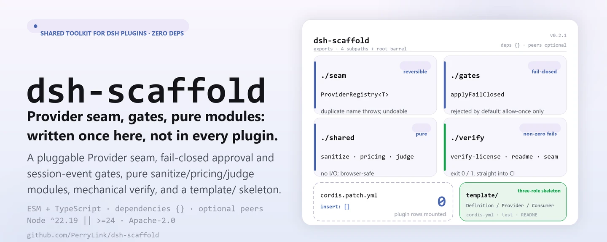
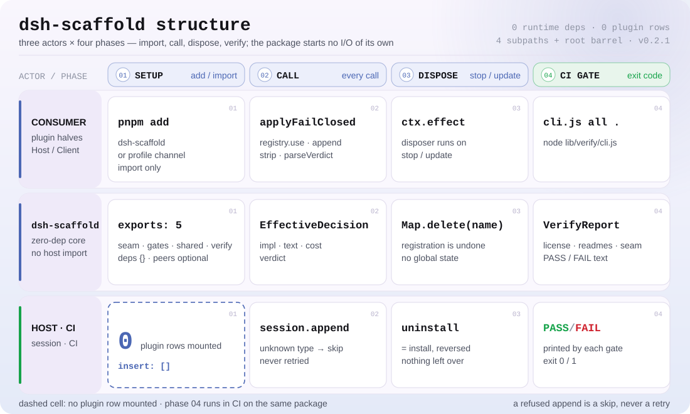

<div align="center">

<picture>
  <source media="(prefers-color-scheme: dark)" srcset="docs/assets/dsh-scaffold-hero-en-dark.webp">
  
</picture>

# dsh-scaffold

**Reunir en un paquete sin dependencias el seam Provider, la puerta de aprobación y sanitize/pricing/judge que cada plugin DSH reescribe.**

Kit compartido para los repositorios de plugins DSH de PerryLink: seam Provider enchufable, puertas de aprobación fail-closed y de eventos de sesión adaptativos, scripts de verificación mecánica, módulos puros compartidos y un esqueleto de plugin nuevo.

[Instalación](#instalación-en-tres-pasos) · [Configuración](#configuración) · [FAQ](#faq) · [简体中文](README.md) · [English](README.en.md) · [Español](README.es.md) · [Português](README.pt.md) · [हिन्दी](README.hi.md)

[](LICENSE)
[](#compatibilidad)
[](https://www.npmjs.com/package/dsh-scaffold)
[](https://github.com/PerryLink/dsh-scaffold/actions/workflows/ci.yml)
[](#compatibilidad)

[](https://github.com/PerryLink/dsh-scaffold/stargazers)
[](https://www.npmjs.com/package/dsh-scaffold)
[](https://dshfind.com/plugins/PerryLink/dsh-scaffold?ref=badge)
[](https://securityscorecards.dev/viewer/?uri=github.com/PerryLink/dsh-scaffold)
[](https://dsh.market/)

```sh
dsh plugin --profile <name> add dsh-scaffold
```

</div>

<sub>Herramienta comunitaria, sin relación con DeepSeek. No es una certificación, auditoría de seguridad ni respaldo oficial: el bloque `dsh.standards` es un marcador `not-run`, no un aprobado. Repositorio canónico: <https://github.com/PerryLink/dsh-scaffold>.</sub>

## Qué es

Una auditoría proyecto por proyecto de más de 20 plugins encontró que cada repositorio escribía a mano el mismo seam Provider y volvía a copiar las mismas formas de sanitización, precios y veredictos. `dsh-scaffold` lo extrae todo en una única biblioteca **ESM + TypeScript, sin dependencias en tiempo de ejecución**: el seam Provider enchufable, la puerta de aprobación fail-closed y la puerta adaptativa de eventos de sesión, los scripts de verificación mecánica, los módulos puros compartidos sanitize/pricing/judge y un esqueleto de plugin nuevo.

Es una biblioteca, no un plugin: no monta ninguna fila de plugin, no registra comandos ni herramientas, no inicia E/S propia y no tiene mitad de navegador; lo único que consume el usuario es un import.

> **Nombre y nombre del paquete.** Este proyecto se llamaba `@perrylink/dsh-plugin-kit` y ahora es **`dsh-scaffold`**; el repo antiguo solo sirve de puntero/copia de seguridad. El nombre de publicación en npm es `dsh-scaffold`; el nombre simple `dsh-scaffold` pertenece a otro proyecto no relacionado: instalarlo no instala este paquete.

```text
plugin consumidor ──import──▶ seam · gates · shared · verify
                                     │
                                     └── esqueleto template/ + cordis.patch.yml (vacío a propósito: sin filas)
```

<picture>
  <source media="(prefers-color-scheme: dark)" srcset="docs/assets/dsh-scaffold-flow-v5-dark.svg">
  
</picture>

## Instalación en tres pasos

1. **Instalar** (elige la que encaje):

   ```sh
   # uso como biblioteca: canal npm
   pnpm add dsh-scaffold

   # uso como biblioteca: canal git (prepare construye lib/ solo con dependencias de producción)
   pnpm add github:PerryLink/dsh-scaffold

   # canal de perfil: que un perfil lo monte por el canal bundle del harness
   dsh plugin --profile web add dsh-scaffold
   dsh plugin --profile web add github:PerryLink/dsh-scaffold
   ```

2. **Sustituir el registro escrito a mano**:

   ```ts
   import { ProviderRegistry } from 'dsh-scaffold/seam'

   const registry = new ProviderRegistry<Detector>({
     default: { name: 'regex', impl: new RegexDetector() },
   })
   ctx.effect(() => registry.register('ner', new NerDetector()))
   const active = registry.use('ner') ?? registry.use()
   ```

3. **Pasar las puertas mecánicas** (un código de salida distinto de cero es un fallo):

   ```sh
   pnpm run build
   node lib/verify/cli.js all .
   ```

**Desinstalar**: `pnpm remove dsh-scaffold` (o borrar la fila del patch del perfil). Nada registra estado global: desinstalar es exactamente lo inverso de instalar.

## Capacidades principales

`dsh-scaffold` convierte en funciones puras y puertas finas las capas que todo repositorio de plugins DSH reescribe; en tiempo de ejecución no importa nada de `@deepseek-ai/*` y no añade dependencias:

- **Seam Provider** — `ProviderRegistry<T>`: registro con nombre, reversible (registrar es un efecto de Cordis) y ruidoso ante nombres duplicados en lugar de sobrescribir en silencio.
- **Puerta de aprobación fail-closed** — `applyFailClosed`: la aprobación nunca concede por defecto; la única vía de concesión es un `allow-once` explícito, y `deny` se asigna a `rejected`.
- **Puerta adaptativa de eventos de sesión** — `maybeAppendSessionEvent` solo añade cuando el host registra el tipo de evento o la envoltura admite sello; un append rechazado se omite, nunca se reintenta de forma que pueda romper la reanudación de sesión.
- **Módulos puros compartidos** — sanitize, pricing y judge en `shared` llevan los mismos nombres y formas que `dsh-mask` / `dsh-budget` / `dsh-auto-review`, así que migrar es mecánico.
- **Puertas mecánicas y esqueleto** — el subpath `verify` trae un `VerifyReport` y un CLI con salida distinta de cero; `template/` es un esqueleto de tres roles (Service Definition / Provider / Consumer).

### Herramientas y superficies

| Subpath | Propósito |
|---|---|
| `seam` | `ProviderRegistry<T>` — registro de providers con nombre, reversible y ruidoso ante duplicados. |
| `gates` | `applyFailClosed`; `makeEventGate` / `maybeAppendSessionEvent` / `probeIgnorableAppend`. |
| `shared` | `sanitize` (`Stripper`, `redactText`, `redactMapping`, `sanitizeText`, `sanitizeUrl`), `pricing` (`BUILTIN_PRICES`, `estimateUsageCost`, `tokenCarbon`, `latencyStats`, `formatMoney`, `formatTokens`), `judge` (`parseVerdict`, `VERDICT_SCHEMA`, `riskExceeds`). |
| `verify` | Puertas mecánicas de CI (`verify-license`, `verify-readme-languages`, `verify-seam`) que devuelven un `VerifyReport`, con CLI de salida distinta de cero: `node lib/verify/cli.js all .` |
| `template/` | Esqueleto de plugin nuevo (`cordis.yml`, plugin de tres roles, test, README, `renovate.json5`). |
| barrel raíz | Reexporta todo lo anterior. |

### Ejemplos

Estos son los puntos de entrada reales de la biblioteca; instala una vez y llama a uno.

**Ejemplo detallado** — comando:

```sh
import { createStripper } from 'dsh-scaffold/shared'
createStripper().strip('call 13800138000 or email a@b.com')
```

Salida:

```text
call <PHONE_1> or email <EMAIL_1>
```

*Observed from `README.md:153 (shared sanitize); src/shared/sanitize.ts:268; test/sanitize.test.ts:8-19`*

**Rama de fallo** — entrada:

```text
const r = new ProviderRegistry(); r.register('openai', impl); r.register('openai', impl)  // second call
```

Salida:

```text
Error: Provider "openai" is already registered
```

*Observed from `plugins/dsh-scaffold/lib/seam/provider.js:55-58; plugins/dsh-scaffold/test/seam.test.ts:27-30; plugins/dsh-scaffold/README.md:164`*

**Ejemplos breves**: `applyFailClosed` · `parseVerdict`

## Configuración

Sin configuración en tiempo de ejecución: las puertas y los ayudantes son funciones puras, sin campos `Config` ni valores por defecto sobrescribibles. La única superficie de configuración es la capa de patch que se publica como `cordis.patch.yml`: un array vacío a propósito para componer perfiles del harness, y el lugar canónico donde los plugins consumidores añaden su propia fila. Este paquete no monta ninguna fila.

Claves más usadas (las usa el plugin consumidor en su propia fila del patch de perfil):

| Clave | Por defecto | Significado |
|---|---|---|
| `insert` | `[]` | Array de filas de la capa de patch; aquí está vacío a propósito: no se monta ninguna fila |
| `id` | — | Identificador de la fila del plugin consumidor (solo aparece en el patch de ese plugin) |
| `name` | — | Nombre de paquete de la fila del plugin consumidor |
| `config` | `{}` | Objeto de configuración de la fila del plugin consumidor |
| `disabled` | `false` | Interruptor de la fila del plugin consumidor |

<details>
<summary>Tabla completa (6 claves)</summary>

| Clave | Por defecto | Significado |
|---|---|---|
| `dsh.bundle.patch` | `./cordis.patch.yml` | Entrada de la capa bundle-patch declarada en package.json; el canal bundle del harness la lee para reconocer este paquete |
| `insert` | `[]` | Array de filas de la capa de patch; aquí está vacío a propósito: no se monta ninguna fila |
| `id` | — | Identificador de la fila del plugin consumidor (solo aparece en el patch de ese plugin) |
| `name` | — | Nombre de paquete de la fila del plugin consumidor |
| `config` | `{}` | Objeto de configuración de la fila del plugin consumidor |
| `disabled` | `false` | Interruptor de la fila del plugin consumidor |

</details>

La fila de patch de un plugin consumidor tiene exactamente esta forma (`cordis.patch.yml` comenta cada clave):

```yaml
insert:
  - id: my-plugin
    name: my-plugin
    config: {}
    # disabled: false
```

## FAQ

<details>
<summary>¿Va a arrastrar dependencias a mi plugin?</summary>

No. `dependencies` es un objeto vacío, así que no hay dependencias en tiempo de ejecución; `@deepseek-ai/cordis`, `@deepseek-ai/schemastery` y los paquetes `@deepseek-ai/dsh-*` son peers **opcionales** (`peerDependenciesMeta` marca cada uno con `optional: true`) y solo sirven para interoperar tipos: si se instalan lo decide tu árbol de dependencias. `pnpm run verify:self-contained` es la puerta que sostiene esta línea.

</details>

<details>
<summary>¿Es un plugin o una biblioteca? ¿Y por qué se puede instalar con `dsh plugin add`?</summary>

Una biblioteca. El paquete trae una capa `dsh.bundle.patch` (`cordis.patch.yml`) que es un array vacío a propósito: montarlo por el canal bundle no añade ninguna fila de plugin, solo permite que este paquete se resuelva junto a un perfil; desinstalarlo lo elimina sin dejar estado global.

</details>

<details>
<summary>Si el host no registra mi tipo de evento de sesión, ¿se pierden auditorías en silencio?</summary>

El append se omite, pero no en silencio: `maybeAppendSessionEvent` solo añade cuando el host registra el tipo o la envoltura admite sello, y un append rechazado se omite sin más, jamás se reintenta de forma que pueda romper la reanudación de sesión (fail closed). `probeIgnorableAppend` sondea antes; un sondeo que lanza se trata como `false`.

</details>

<details>
<summary>¿La puerta de aprobación concede alguna vez por defecto?</summary>

No. El valor por defecto es `rejected`; la única vía de concesión es un `allow-once` explícito. `deny` se asigna a `rejected`, y `'delegate'` no tiene equivalente en el veredicto, así que resuelve a `deny` mientras `EffectiveDecision.policy` conserva `'delegate'`.

</details>

<details>
<summary>¿Hay mitad de navegador? ¿Puedo usarlo directamente en un cliente?</summary>

No hay mitad de UI de navegador. El núcleo puro (`seam`, `gates`, `shared`) es browser-safe, pero el paquete completo es una biblioteca que consumen las mitades Host (y opcionalmente Client) de otros plugins, y no incluye ninguna interfaz.

</details>

## Límites de seguridad

- `sanitize`/`redact*` son **higiene de presentación**, no un límite de seguridad: reducen la fuga hacia logs y resultados, pero no autentican ni autorizan.
- Las puertas de aprobación fallan cerradas por defecto (`rejected`); la única vía de concesión es un `allow-once` explícito.
- Los append de eventos de sesión que el host rechaza se omiten, nunca se reintentan de forma que pueda romper la reanudación de sesión.
- Reporta vulnerabilidades por GitHub Security Advisories — ver `SECURITY.md`.

## Permisos y datos

El kit no realiza ninguna E/S, ningún acceso a red ni ningún lanzamiento de subprocesos por su cuenta. `Stripper` mantiene el mapeo marcador→original solo en memoria, y `stats()`/`redactMapping()` nunca emiten texto plano; un consumidor que persista un mapeo asume esa decisión y los permisos de almacenamiento que conlleva.

## Limitaciones conocidas

- Los hosts cuyo tercer argumento de `Session.append` es un `SurfaceIntent` (`0.1.2-rc.1`) lanzan `validateNext` en el sondeo de la envoltura ignorable; la puerta degrada a omitir-lo-desconocido, así que en esos hosts los eventos de auditoría se descartan (fail closed) en lugar de registrarse.
- `0.1.2-rc.1` (adaptado el 2026-09-02): la envoltura de sesión conserva su campo ignorable solo por compatibilidad de lectura de logs ya guardados — `Session.append` sigue sin poder sellarlo, así que el comportamiento de la puerta de auditoría no cambia.
- El kit no incluye mitad de UI de navegador; es una biblioteca que consumen las mitades Host (y opcionalmente Client) de otros plugins.

## Interoperabilidad con otros plugins DSH

Este paquete es una biblioteca, no un plugin, así que su huella sobre otros plugins es "cero registro": cada punto se deduce directamente del manifiesto del paquete y de las fuentes de este repo, sin necesidad de sondear nada.

- **Ninguna fila de plugin.** `cordis.patch.yml` es un array vacío a propósito: incluso por el canal bundle no aparece ninguna fila de plugin.
- **Ninguna clave de servicio.** No hay `ctx.provide()`, así que ninguna clave de servicio puede colisionar.
- **Ningún comando, herramienta, slot de cliente ni prefijo `webServer`.** Esas superficies quedan enteramente en el plugin consumidor.
- **Ningún import de host en tiempo de ejecución.** Cada entrada `@deepseek-ai/*` es un peer opcional que solo sirve para tipos.
- **Ninguna mutación global.** No parchea prototipos, no reescribe `process.env` ni reemplaza el dispatcher global de fetch.
- **Compatibilidad de línea.** Nombres y formas replican `dsh-mask` (sanitize), `dsh-budget` (pricing) y `dsh-auto-review` (judge y el vocabulario `fallbackPolicy`), así que los plugins de la familia comparten una misma convención de llamada.

## Compatibilidad

| Superficie | Estado |
|---|---|
| Harness | Cero imports de `@deepseek-ai/*` en tiempo de ejecución; `@deepseek-ai/cordis` (`^4.0.6-alpha.2`), `@deepseek-ai/schemastery` (`^3.18.6-alpha.2`) y los paquetes `@deepseek-ai/dsh-*` son peers **opcionales** en la banda `>=0.1.2-rc.1 <0.2.0 \|\| >=0.1.5-alpha.1 <0.2.0 \|\| >=0.1.6-0 <0.2.0 \|\| >=0.1.7-0 <0.2.0 \|\| >=0.2.0-0 <0.3.0 \|\| >=0.2.1-0 <0.3.0 \|\| >=0.2.2-0 <0.3.0`, solo para interoperar tipos. Verificado el 2026-09-11 contra el checkout master `dsh-v0.1.7-alpha.1` (cadena completa de puertas + smoke de instalación de perfil) y re-verificado el 2026-10-05 contra el checkout `dsh-v0.2.1-alpha.1` (mismas comprobaciones). |
| Node | `^22.19.0 \|\| >=24.0.0`, solo ESM |
| Plataformas | Donde sea que corra DSH (biblioteca pura, sin mitad de navegador) |
| Modelo | Irrelevante: el kit no llama a ningún modelo |
| Compatibilidad de línea | Nombres y formas replican `dsh-mask` (sanitize), `dsh-budget` (pricing) y `dsh-auto-review` (judge y el vocabulario `fallbackPolicy`), así que migrar es mecánico |

## Ecosistema y calidad

- [Página de dshfind](https://dshfind.com/plugins/PerryLink/dsh-scaffold) (instalaciones y ranking)
- [Informe OpenSSF Scorecard](https://securityscorecards.dev/viewer/?uri=github.com/PerryLink/dsh-scaffold) (impulsado por [.github/workflows/scorecard.yml](.github/workflows/scorecard.yml))
- [DSH Market](https://dsh.market/) (listado)
- **Canal de la tienda 1024**: primero `npm i -g dsh1024`, luego `dsh1024 plugin --profile web add dsh-scaffold` (cuenta para el ranking de instalaciones de [deepseek1024.com](https://deepseek1024.com))
- [Base de conocimiento del ecosistema](https://perrylink.github.io/dsh-plugin-guide/): guía de desarrollo de plugins · datos de selección · criterios de mantenimiento

## Desarrollo

```sh
pnpm install
pnpm run typecheck            # tsc --noEmit
pnpm run typecheck:ci         # cara de CI: tsc -p tsconfig.ci.json --noEmit
pnpm run typecheck:checkout   # cara de checkout: tsc -p tsconfig.checkout.json --noEmit
pnpm test                     # tests unitarios con vitest
pnpm run build                # emite lib/ + declaraciones (prepare también lo ejecuta)
pnpm run verify:self-contained
pnpm run verify:artifacts
pnpm run check:readmes        # consistencia de los README en cinco idiomas
pnpm pack                     # el tarball publicado
```

Las imágenes del README las genera programáticamente [`scripts/gen-readme-assets.py`](scripts/gen-readme-assets.py) (SVG escrito a mano, variantes clara y oscura, se puede volver a ejecutar); este repositorio no trae datos de benchmark, así que no hay gráfico de evidencia.

Este repositorio es también el centro de mantenimiento del ecosistema: `scripts/sync-peer-range.mjs` vuelve a fijar la banda peer compartida en todos los repos del directorio objetivo con un solo comando, `renovate/default.json5` es el preset de Renovate que todos los repos extienden, `.github/workflows/npm-publish.yml` es un workflow de publicación reutilizable disparado por tag (solo necesita un secret `NPM_TOKEN`) y `data/repos.json` es el registro del ecosistema que consume el portal — el registro es la cifra de referencia y este README no repite sus números. Ver [`docs/ecosystem-tooling.md`](docs/ecosystem-tooling.md).

Topics: `dsh`, `dsh-plugin`, `deepseek-harness`, `deepseek`, `cordis`, `perrylink`, `provider`, `seam`, `approval`, `sanitize`, `pricing`, `judge`

## Familia y agradecimientos

Este proyecto forma parte de la familia de plugins de DeepSeek Harness de [PerryLink](https://github.com/PerryLink) (todos Apache-2.0), y es su centro de mantenimiento. Si este kit te sirve, **una estrella ayuda a que la siguiente persona lo encuentre** — no desbloquea nada.

- [@PerryLink](https://github.com/PerryLink) — creador y mantenedor: el seam Provider, las puertas de aprobación y de eventos de sesión, los módulos puros sanitize/pricing/judge, los scripts de verificación, el esqueleto `template/` y la documentación en cinco idiomas.
- [dsh-mask](https://github.com/PerryLink/dsh-mask) · [dsh-budget](https://github.com/PerryLink/dsh-budget) · [dsh-auto-review](https://github.com/PerryLink/dsh-auto-review) — las implementaciones originales de las que se extrajo este kit; ellas definen la compatibilidad de línea.

<details>
<summary>Expandir todos los plugins</summary>

| Plugin | Estado |
|---|---|
| **[dsh-aqua-input-check](https://github.com/PerryLink/dsh-aqua-input-check)** |  |
| **[dsh-archive-check](https://github.com/PerryLink/dsh-archive-check)** |  |
| **[dsh-auto-review](https://github.com/PerryLink/dsh-auto-review)** |  |
| **[dsh-autotier](https://github.com/PerryLink/dsh-autotier)** | 🧊 CONGELADO — ver el README del repo |
| **[dsh-bid-ca-precheck](https://github.com/PerryLink/dsh-bid-ca-precheck)** |  |
| **[dsh-bid-qual-check](https://github.com/PerryLink/dsh-bid-qual-check)** |  |
| **[dsh-cert-mcp](https://github.com/PerryLink/dsh-cert-mcp)** | 🧊 CONGELADO — ver el README del repo |
| **[dsh-checkpoint-rewind](https://github.com/PerryLink/dsh-checkpoint-rewind)** |  |
| **[dsh-click](https://github.com/PerryLink/dsh-click)** |  |
| **[dsh-composer-history](https://github.com/PerryLink/dsh-composer-history)** |  |
| **[dsh-contract-stance](https://github.com/PerryLink/dsh-contract-stance)** |  |
| **[dsh-customs-doc-check](https://github.com/PerryLink/dsh-customs-doc-check)** |  |
| **[dsh-data-quality](https://github.com/PerryLink/dsh-data-quality)** | 🧊 CONGELADO — ver el README del repo |
| **[dsh-demurrage-ledger](https://github.com/PerryLink/dsh-demurrage-ledger)** |  |
| **[dsh-doublecheck](https://github.com/PerryLink/dsh-doublecheck)** |  |
| **[dsh-drill-script-check](https://github.com/PerryLink/dsh-drill-script-check)** |  |
| **[dsh-eia-guide-check](https://github.com/PerryLink/dsh-eia-guide-check)** |  |
| **[dsh-emergency-plan](https://github.com/PerryLink/dsh-emergency-plan)** |  |
| **[dsh-essay-rubric-check](https://github.com/PerryLink/dsh-essay-rubric-check)** |  |
| **[dsh-evidence-check](https://github.com/PerryLink/dsh-evidence-check)** |  |
| **[dsh-export-ctl-check](https://github.com/PerryLink/dsh-export-ctl-check)** |  |
| **[dsh-fast](https://github.com/PerryLink/dsh-fast)** |  |
| **[dsh-fmea-table-check](https://github.com/PerryLink/dsh-fmea-table-check)** |  |
| **[dsh-forecast-penalty](https://github.com/PerryLink/dsh-forecast-penalty)** |  |
| **[dsh-fund-research](https://github.com/PerryLink/dsh-fund-research)** |  |
| **[dsh-github](https://github.com/PerryLink/dsh-github)** |  |
| **[dsh-gongwen-flow-check](https://github.com/PerryLink/dsh-gongwen-flow-check)** |  |
| **[dsh-gongwen-word-check](https://github.com/PerryLink/dsh-gongwen-word-check)** |  |
| **[dsh-guard-plan-qc](https://github.com/PerryLink/dsh-guard-plan-qc)** |  |
| **[dsh-hazchem-check](https://github.com/PerryLink/dsh-hazchem-check)** |  |
| **[dsh-hazplan-check](https://github.com/PerryLink/dsh-hazplan-check)** |  |
| **[dsh-hidden-risk-map](https://github.com/PerryLink/dsh-hidden-risk-map)** |  |
| **[dsh-hs-classify](https://github.com/PerryLink/dsh-hs-classify)** |  |
| **[dsh-icd-rule-check](https://github.com/PerryLink/dsh-icd-rule-check)** |  |
| **[dsh-industry-research](https://github.com/PerryLink/dsh-industry-research)** |  |
| **[dsh-lawcite-adapter](https://github.com/PerryLink/dsh-lawcite-adapter)** |  |
| **[dsh-laya](https://github.com/PerryLink/dsh-laya)** |  |
| **[dsh-lc-doc-check](https://github.com/PerryLink/dsh-lc-doc-check)** |  |
| **[dsh-learning-gap-check](https://github.com/PerryLink/dsh-learning-gap-check)** |  |
| **[dsh-library](https://github.com/PerryLink/dsh-library)** |  |
| **[dsh-local-ai](https://github.com/PerryLink/dsh-local-ai)** |  |
| **[dsh-lsp-actions](https://github.com/PerryLink/dsh-lsp-actions)** |  |
| **[dsh-mask](https://github.com/PerryLink/dsh-mask)** |  |
| **[dsh-mcp-panel](https://github.com/PerryLink/dsh-mcp-panel)** |  |
| **[dsh-medrec-qc](https://github.com/PerryLink/dsh-medrec-qc)** |  |
| **[dsh-memento](https://github.com/PerryLink/dsh-memento)** | 🧊 CONGELADO — ver el README del repo |
| **[dsh-nsfc-form-check](https://github.com/PerryLink/dsh-nsfc-form-check)** |  |
| **[dsh-nurse-record-check](https://github.com/PerryLink/dsh-nurse-record-check)** |  |
| **[dsh-observe](https://github.com/PerryLink/dsh-observe)** |  |
| **[dsh-origin-rvc-check](https://github.com/PerryLink/dsh-origin-rvc-check)** |  |
| **[dsh-ota-review-check](https://github.com/PerryLink/dsh-ota-review-check)** |  |
| **[dsh-output-styles](https://github.com/PerryLink/dsh-output-styles)** |  |
| **[dsh-paper-doc-adapter](https://github.com/PerryLink/dsh-paper-doc-adapter)** |  |
| **[dsh-permission-rules](https://github.com/PerryLink/dsh-permission-rules)** |  |
| **[dsh-permit-report-check](https://github.com/PerryLink/dsh-permit-report-check)** |  |
| **[dsh-pipeline-check](https://github.com/PerryLink/dsh-pipeline-check)** |  |
| **[dsh-pleading-draft](https://github.com/PerryLink/dsh-pleading-draft)** |  |
| **[dsh-plugin-doctor](https://github.com/PerryLink/dsh-plugin-doctor)** | 🚫 RETIRADO (repo archivado) |
| **[dsh-plugin-guide](https://github.com/PerryLink/dsh-plugin-guide)** |  |
| **[dsh-scaffold](https://github.com/PerryLink/dsh-scaffold)** |  |
| **[dsh-plugin-upgrade](https://github.com/PerryLink/dsh-plugin-upgrade)** | 🚫 RETIRADO (repo archivado) |
| **[dsh-policy-brief-draft](https://github.com/PerryLink/dsh-policy-brief-draft)** |  |
| **[dsh-power-loss-split](https://github.com/PerryLink/dsh-power-loss-split)** |  |
| **[dsh-power-ticket-check](https://github.com/PerryLink/dsh-power-ticket-check)** |  |
| **[dsh-ppap-check](https://github.com/PerryLink/dsh-ppap-check)** |  |
| **[dsh-protest-deadline](https://github.com/PerryLink/dsh-protest-deadline)** |  |
| **[dsh-railway-window](https://github.com/PerryLink/dsh-railway-window)** |  |
| **[dsh-repair-order-qc](https://github.com/PerryLink/dsh-repair-order-qc)** |  |
| **[dsh-research-report](https://github.com/PerryLink/dsh-research-report)** |  |
| **[dsh-review-reply-check](https://github.com/PerryLink/dsh-review-reply-check)** |  |
| **[dsh-rulefile-check](https://github.com/PerryLink/dsh-rulefile-check)** |  |
| **[dsh-safety-brief-check](https://github.com/PerryLink/dsh-safety-brief-check)** |  |
| **[dsh-score](https://github.com/PerryLink/dsh-score)** | 🧊 CONGELADO — ver el README del repo |
| **[dsh-session-sync](https://github.com/PerryLink/dsh-session-sync)** |  |
| **[dsh-site-log-check](https://github.com/PerryLink/dsh-site-log-check)** |  |
| **[dsh-skill-pack-security](https://github.com/PerryLink/dsh-skill-pack-security)** |  |
| **[dsh-soe-decision-check](https://github.com/PerryLink/dsh-soe-decision-check)** |  |
| **[dsh-soilwater-check](https://github.com/PerryLink/dsh-soilwater-check)** |  |
| **[dsh-sop-sync-check](https://github.com/PerryLink/dsh-sop-sync-check)** |  |
| **[dsh-spc-gbt-adapter](https://github.com/PerryLink/dsh-spc-gbt-adapter)** |  |
| **[dsh-talk](https://github.com/PerryLink/dsh-talk)** |  |
| **[dsh-tender-extract](https://github.com/PerryLink/dsh-tender-extract)** |  |
| **[dsh-tender-matrix](https://github.com/PerryLink/dsh-tender-matrix)** |  |
| **[dsh-test-drive](https://github.com/PerryLink/dsh-test-drive)** |  |
| **[dsh-ticktick](https://github.com/PerryLink/dsh-ticktick)** | 🚫 RETIRADO (repo archivado) |
| **[dsh-translate](https://github.com/PerryLink/dsh-translate)** |  |
| **[dsh-warranty-calc](https://github.com/PerryLink/dsh-warranty-calc)** |  |
| **[dsh-community-bench](https://github.com/PerryLink/dsh-community-bench)** | 🧊 CONGELADO — ver el README del repo |
| **[dsh-budget](https://github.com/PerryLink/dsh-budget)** | 🧊 CONGELADO — ver el README del repo |
| **[dsh-claude-move](https://github.com/PerryLink/dsh-claude-move)** | 🧊 CONGELADO — ver el README del repo |
| **[dsh-defend](https://github.com/PerryLink/dsh-defend)** | 🧊 CONGELADO — ver el README del repo |
| **[dsh-draw](https://github.com/PerryLink/dsh-draw)** | 🧊 CONGELADO — ver el README del repo |
| **[dsh-reach](https://github.com/PerryLink/dsh-reach)** | 🧊 CONGELADO — ver el README del repo |
| **[dsh-background-agents](https://github.com/PerryLink/dsh-background-agents)** | 🚫 RETIRADO (repo archivado) |
| **[dsh-session-pin](https://github.com/PerryLink/dsh-session-pin)** | 🚫 RETIRADO (repo archivado) |
| **[dsh-team-rooms](https://github.com/PerryLink/dsh-team-rooms)** | 🚫 RETIRADO (repo archivado) |

</details>

## Licencia

[LICENSE](LICENSE) (Apache License 2.0) © 2026 dsh-scaffold contributors

<p align="center"><sub>Apache-2.0 · Herramienta comunitaria, sin relación con DeepSeek.</sub></p>
