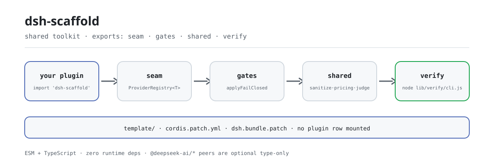

<div align="center">

<picture>
  <source media="(prefers-color-scheme: dark)" srcset="docs/assets/dsh-scaffold-flow-dark.svg">
  
</picture>

# dsh-scaffold

**हर DSH प्लगइन जिस Provider seam, अनुमोदन गेट और sanitize/pricing/judge को दोबारा लिखता है, उन्हें एक शून्य-निर्भरता पैकेज में समेटें।**

PerryLink DSH प्लगइन रिपॉज़िटरीज़ के लिए साझा टूलकिट: प्लगेबल Provider seam, fail-closed अनुमोदन और अनुकूली सत्र-घटना गेट, यांत्रिक verify स्क्रिप्ट, साझा शुद्ध मॉड्यूल, और नए प्लगइन का ढाँचा।

[इंस्टॉल](#तीन-चरणों-में-शुरुआत) · [कॉन्फ़िगरेशन](#कॉन्फ़िगरेशन) · [FAQ](#faq) · [简体中文](README.md) · [English](README.en.md) · [Español](README.es.md) · [Português](README.pt.md) · [हिन्दी](README.hi.md)

[](LICENSE)
[](#अनुकूलता)
[](https://www.npmjs.com/package/dsh-scaffold)
[](https://github.com/PerryLink/dsh-scaffold/actions/workflows/ci.yml)
[](#अनुकूलता)

[](https://github.com/PerryLink/dsh-scaffold/stargazers)
[](https://www.npmjs.com/package/dsh-scaffold)
[](https://dshfind.com/plugins/PerryLink/dsh-scaffold?ref=badge)
[](https://securityscorecards.dev/viewer/?uri=github.com/PerryLink/dsh-scaffold)
[](https://dsh.market/)

```sh
dsh plugin --profile <name> add dsh-scaffold
```

</div>

<sub>सामुदायिक टूल, DeepSeek से संबद्ध नहीं। यह प्रमाणन, सुरक्षा ऑडिट या आधिकारिक समर्थन नहीं है: `dsh.standards` ब्लॉक एक `not-run` प्लेसहोल्डर है, पास नहीं। कैनोनिकल रेपो: <https://github.com/PerryLink/dsh-scaffold>।</sub>

## यह क्या है

20+ प्लगइन के प्रति-प्रोजेक्ट ऑडिट में पाया गया कि हर रेपो वही Provider seam हाथ से लिख रहा था और वही sanitize, pricing व निर्णय (verdict) आकृतियाँ दोबारा कॉपी कर रहा था। `dsh-scaffold` यह सब एक **ESM + TypeScript, शून्य-रनटाइम-निर्भरता** लाइब्रेरी में निकालता है: प्लगेबल Provider seam, fail-closed अनुमोदन गेट और अनुकूली सत्र-घटना गेट, यांत्रिक verify स्क्रिप्ट, साझा sanitize/pricing/judge शुद्ध मॉड्यूल, और नए प्लगइन का ढाँचा।

यह लाइब्रेरी है, प्लगइन नहीं: कोई प्लगइन पंक्ति माउंट नहीं करता, कोई कमांड या टूल पंजीकृत नहीं करता, अपनी ओर से कोई I/O नहीं करता, और इसका कोई ब्राउज़र-आधा नहीं है; उपभोक्ता केवल एक import लेता है।

> **नाम और पैकेज नाम।** यह प्रोजेक्ट पहले `@perrylink/dsh-plugin-kit` था और अब **`dsh-scaffold`** है; पुराना रेपो केवल पॉइंटर/बैकअप है। npm प्रकाशन नाम `dsh-scaffold` है; सादा नाम `dsh-scaffold` किसी असंबंधित प्रोजेक्ट का है — उसे इंस्टॉल करने से यह पैकेज इंस्टॉल नहीं होता।

```text
उपभोक्ता प्लगइन ──import──▶ seam · gates · shared · verify
                                     │
                                     └── template/ ढाँचा + cordis.patch.yml (जान-बूझकर खाली: कोई पंक्ति नहीं)
```

## तीन चरणों में शुरुआत

1. **इंस्टॉल करें** (जो सूट करे वह चुनें):

   ```sh
   # लाइब्रेरी उपयोग: npm चैनल
   pnpm add dsh-scaffold

   # लाइब्रेरी उपयोग: git चैनल (prepare केवल production निर्भरताओं से lib/ बनाता है)
   pnpm add github:PerryLink/dsh-scaffold

   # profile चैनल: profile को harness bundle चैनल से माउंट करने दें
   dsh plugin --profile web add dsh-scaffold
   dsh plugin --profile web add github:PerryLink/dsh-scaffold
   ```

2. **हाथ से लिखा रजिस्ट्री बदलें**:

   ```ts
   import { ProviderRegistry } from 'dsh-scaffold/seam'

   const registry = new ProviderRegistry<Detector>({
     default: { name: 'regex', impl: new RegexDetector() },
   })
   ctx.effect(() => registry.register('ner', new NerDetector()))
   const active = registry.use('ner') ?? registry.use()
   ```

3. **यांत्रिक गेट चलाएँ** (गैर-शून्य exit कोड = विफलता):

   ```sh
   pnpm run build
   node lib/verify/cli.js all .
   ```

**अनइंस्टॉल**: `pnpm remove dsh-scaffold` (या profile patch से वह पंक्ति हटाएँ)। कोई वैश्विक स्थिति पंजीकृत नहीं होती: अनइंस्टॉल इंस्टॉल का ठीक उल्टा है।

## मुख्य क्षमताएँ

`dsh-scaffold` उन परतों को शुद्ध फ़ंक्शन और पतले गेट में बदल देता है जिन्हें हर DSH प्लगइन रेपो दोबारा लिखता है; रनटाइम पर यह `@deepseek-ai/*` से कुछ भी import नहीं करता और कोई निर्भरता नहीं जोड़ता:

- **Provider seam** — `ProviderRegistry<T>`: नाम-आधारित पंजीकरण, प्रतिवर्ती (पंजीकरण एक Cordis effect है), और डुप्लिकेट नाम पर चुपचाप ओवरराइट करने के बजाय स्पष्ट विफलता।
- **fail-closed अनुमोदन गेट** — `applyFailClosed`: अनुमोदन कभी डिफ़ॉल्ट से नहीं मिलता; एकमात्र मार्ग स्पष्ट `allow-once` है, और `deny` का मान `rejected` है।
- **अनुकूली सत्र-घटना गेट** — `maybeAppendSessionEvent` केवल तब जोड़ता है जब होस्ट वह घटना प्रकार दर्ज करता हो या envelope पर मुहर लग सकती हो; अस्वीकृत append छोड़ दिया जाता है, कभी ऐसे दोबारा नहीं आज़माया जाता जिससे सत्र-पुनरारंभ टूट सके।
- **साझा शुद्ध मॉड्यूल** — `shared` में sanitize, pricing और judge के नाम व आकृतियाँ `dsh-mask` / `dsh-budget` / `dsh-auto-review` जैसी ही हैं, इसलिए माइग्रेशन यांत्रिक है।
- **यांत्रिक गेट और ढाँचा** — `verify` subpath में `VerifyReport` और गैर-शून्य exit वाला CLI है; `template/` तीन-भूमिका वाला नया प्लगइन ढाँचा है (Service Definition / Provider / Consumer)।

### टूल और सतहें

| Subpath | उद्देश्य |
|---|---|
| `seam` | `ProviderRegistry<T>` — प्रतिवर्ती, डुप्लिकेट पर स्पष्ट विफलता देने वाली नाम-आधारित provider रजिस्ट्री। |
| `gates` | `applyFailClosed`; `makeEventGate` / `maybeAppendSessionEvent` / `probeIgnorableAppend`. |
| `shared` | `sanitize` (`Stripper`, `redactText`, `redactMapping`, `sanitizeText`, `sanitizeUrl`), `pricing` (`BUILTIN_PRICES`, `estimateUsageCost`, `tokenCarbon`, `latencyStats`, `formatMoney`, `formatTokens`), `judge` (`parseVerdict`, `VERDICT_SCHEMA`, `riskExceeds`)। |
| `verify` | यांत्रिक CI गेट (`verify-license`, `verify-readme-languages`, `verify-seam`) जो `VerifyReport` लौटाते हैं, गैर-शून्य exit CLI के साथ: `node lib/verify/cli.js all .` |
| `template/` | नया प्लगइन ढाँचा (`cordis.yml`, तीन-भूमिका प्लगइन, टेस्ट, README, `renovate.json5`)। |
| रूट barrel | ऊपर के सभी को पुनः निर्यात करता है। |

### उदाहरण

ये लाइब्रेरी के वास्तविक प्रवेश-बिंदु हैं; एक बार इंस्टॉल करें, फिर एक चलाएँ।

**विस्तृत उदाहरण** — कमांड:

```sh
import { createStripper } from 'dsh-scaffold/shared'
createStripper().strip('call 13800138000 or email a@b.com')
```

आउटपुट:

```text
call <PHONE_1> or email <EMAIL_1>
```

*Observed from `README.md:153 (shared sanitize); src/shared/sanitize.ts:268; test/sanitize.test.ts:8-19`*

**विफलता शाखा** — इनपुट:

```text
const r = new ProviderRegistry(); r.register('openai', impl); r.register('openai', impl)  // second call
```

आउटपुट:

```text
Error: Provider "openai" is already registered
```

*Observed from `plugins/dsh-scaffold/lib/seam/provider.js:55-58; plugins/dsh-scaffold/test/seam.test.ts:27-30; plugins/dsh-scaffold/README.md:164`*

**संक्षिप्त उदाहरण**: `applyFailClosed` · `parseVerdict`

## कॉन्फ़िगरेशन

रनटाइम कॉन्फ़िगरेशन नहीं है: गेट और सहायक फ़ंक्शन शुद्ध हैं, कोई `Config` फ़ील्ड नहीं, कोई ओवरराइड करने योग्य डिफ़ॉल्ट नहीं। एकमात्र कॉन्फ़िगरेशन सतह पैकेज के साथ आने वाली bundle-patch परत `cordis.patch.yml` है — यह जान-बूझकर खाली array है, harness profile संयोजन के लिए, और वह कैनोनिकल जगह जहाँ उपभोक्ता प्लगइन अपनी पंक्ति जोड़ते हैं; यह पैकेज कोई पंक्ति माउंट नहीं करता।

सबसे अधिक उपयोग होने वाली कुंजियाँ (उपभोक्ता प्लगइन अपनी profile-patch पंक्ति में इन्हें उपयोग करता है):

| कुंजी | डिफ़ॉल्ट | अर्थ |
|---|---|---|
| `insert` | `[]` | patch परत की पंक्ति-array; यहाँ जान-बूझकर खाली है: कोई प्लगइन पंक्ति माउंट नहीं होती |
| `id` | — | उपभोक्ता प्लगइन पंक्ति का पहचानकर्ता (केवल उसी प्लगइन के patch में आता है) |
| `name` | — | उपभोक्ता प्लगइन पंक्ति का पैकेज नाम |
| `config` | `{}` | उपभोक्ता प्लगइन पंक्ति का config ऑब्जेक्ट |
| `disabled` | `false` | उपभोक्ता प्लगइन पंक्ति का स्विच |

<details>
<summary>पूरी तालिका (6 कुंजियाँ)</summary>

| कुंजी | डिफ़ॉल्ट | अर्थ |
|---|---|---|
| `dsh.bundle.patch` | `./cordis.patch.yml` | package.json में घोषित bundle-patch प्रवेश; harness bundle चैनल इसी से यह पैकेज पहचानता है |
| `insert` | `[]` | patch परत की पंक्ति-array; यहाँ जान-बूझकर खाली है: कोई प्लगइन पंक्ति माउंट नहीं होती |
| `id` | — | उपभोक्ता प्लगइन पंक्ति का पहचानकर्ता (केवल उसी प्लगइन के patch में आता है) |
| `name` | — | उपभोक्ता प्लगइन पंक्ति का पैकेज नाम |
| `config` | `{}` | उपभोक्ता प्लगइन पंक्ति का config ऑब्जेक्ट |
| `disabled` | `false` | उपभोक्ता प्लगइन पंक्ति का स्विच |

</details>

उपभोक्ता प्लगइन की patch पंक्ति ठीक ऐसी दिखती है (`cordis.patch.yml` हर कुंजी पर टिप्पणी करता है):

```yaml
insert:
  - id: my-plugin
    name: my-plugin
    config: {}
    # disabled: false
```

## FAQ

<details>
<summary>क्या यह मेरे प्लगइन में निर्भरताएँ घुसा देगा?</summary>

नहीं। `dependencies` खाली ऑब्जेक्ट है, इसलिए रनटाइम पर शून्य निर्भरता; `@deepseek-ai/cordis`, `@deepseek-ai/schemastery` और सभी `@deepseek-ai/dsh-*` **वैकल्पिक** peer हैं (`peerDependenciesMeta` में हर एक `optional: true`), केवल टाइप इंटरऑप के लिए — इंस्टॉल हों या न हों, यह आपके डिपेंडेंसी ट्री का निर्णय है। `pnpm run verify:self-contained` इसी रेखा की रखवाली करने वाला गेट है।

</details>

<details>
<summary>यह प्लगइन है या लाइब्रेरी? फिर `dsh plugin add` से क्यों इंस्टॉल होता है?</summary>

लाइब्रेरी। पैकेज के साथ `dsh.bundle.patch` परत (`cordis.patch.yml`) आती है जो जान-बूझकर खाली array है: bundle चैनल से माउंट करने पर कोई प्लगइन पंक्ति नहीं जुड़ती, बस यह पैकेज किसी profile के साथ resolve हो पाता है; अनइंस्टॉल पर हट जाता है, कोई वैश्विक स्थिति नहीं बचती।

</details>

<details>
<summary>अगर होस्ट मेरा सत्र-घटना प्रकार दर्ज नहीं करता, तो ऑडिट चुपचाप खो जाता है?</summary>

append छोड़ दिया जाता है, पर चुपचाप नहीं: `maybeAppendSessionEvent` केवल तब जोड़ता है जब होस्ट वह प्रकार दर्ज करता हो या envelope पर मुहर लग सकती हो, और अस्वीकृत append सीधे छोड़ दिया जाता है — कभी ऐसे दोबारा नहीं आज़माया जाता जिससे सत्र-पुनरारंभ टूट सके (fail closed)। `probeIgnorableAppend` पहले जाँचता है; जाँच के दौरान उठा अपवाद `false` माना जाता है।

</details>

<details>
<summary>क्या अनुमोदन गेट कभी डिफ़ॉल्ट से अनुमति देता है?</summary>

नहीं। डिफ़ॉल्ट `rejected` है; एकमात्र मार्ग स्पष्ट `allow-once` है। `deny` का मान `rejected` है, और `'delegate'` का निर्णय-स्तर पर कोई समतुल्य नहीं, इसलिए वह `deny` बनता है जबकि `EffectiveDecision.policy` में `'delegate'` बना रहता है।

</details>

<details>
<summary>क्या ब्राउज़र-आधा है? क्या इसे सीधे क्लाइंट में उपयोग कर सकते हैं?</summary>

ब्राउज़र UI का कोई आधा नहीं है। शुद्ध कोर (`seam`, `gates`, `shared`) browser-safe है, पर पूरा पैकेज अन्य प्लगइन के Host (और वैकल्पिक रूप से Client) आधे द्वारा उपभोग की जाने वाली लाइब्रेरी है और कोई इंटरफ़ेस नहीं देता।

</details>

## सुरक्षा सीमाएँ

- `sanitize`/`redact*` **प्रदर्शन स्वच्छता** हैं, सुरक्षा सीमा नहीं: वे लॉग और परिणामों में लीक कम करते हैं, पर प्रमाणीकरण या अनुमोदन नहीं करते।
- अनुमोदन गेट डिफ़ॉल्ट रूप से fail closed (`rejected`) हैं; एकमात्र मार्ग स्पष्ट `allow-once` विकल्प है।
- होस्ट जिन सत्र-घटना appends को अस्वीकार करता है, वे छोड़ दिए जाते हैं, कभी ऐसे दोबारा नहीं आज़माए जाते जिससे सत्र-पुनरारंभ टूट सके।
- कमज़ोरियाँ GitHub Security Advisories से रिपोर्ट करें — देखें `SECURITY.md`।

## अनुमतियाँ और डेटा

यह किट स्वयं कोई I/O, कोई नेटवर्क एक्सेस और कोई subprocess स्पॉन नहीं करती। `Stripper` प्लेसहोल्डर→मूल मैपिंग केवल मेमोरी में रखता है, और `stats()`/`redactMapping()` कभी सादा टेक्स्ट नहीं देते; यदि उपभोक्ता मैपिंग को सहेजता है तो वह निर्णय और उसके साथ आने वाली स्टोरेज अनुमतियाँ उसी की ज़िम्मेदारी हैं।

## ज्ञात सीमाएँ

- जिन होस्ट में `Session.append` का तीसरा आर्ग्युमेंट `SurfaceIntent` है (`0.1.2-rc.1`), वे ignorable-envelope जाँच पर `validateNext` फेंकते हैं; गेट अज्ञात-को-छोड़ो पर उतर आता है, इसलिए उन होस्ट पर ऑडिट घटनाएँ दर्ज होने के बजाय छोड़ दी जाती हैं (fail closed)।
- `0.1.2-rc.1` (2026-09-02 को अनुकूलित): सत्र envelope अपना ignorable फ़ील्ड केवल संग्रहीत लॉग पढ़ने की संगतता के लिए रखता है — `Session.append` उस पर मुहर अब भी नहीं लगा सकता, इसलिए ऑडिट-गेट का व्यवहार अपरिवर्तित है।
- किट में ब्राउज़र UI का कोई आधा नहीं है; यह अन्य प्लगइन के Host (और वैकल्पिक रूप से Client) आधे द्वारा उपभोग की जाने वाली लाइब्रेरी है।

## अन्य DSH प्लगइन के साथ इंटरऑपरेबिलिटी

यह पैकेज प्लगइन नहीं, लाइब्रेरी है, इसलिए अन्य प्लगइन पर इसका असर "शून्य पंजीकरण" है — नीचे का हर बिंदु सीधे पैकेज मैनिफ़ेस्ट और इस रेपो के सोर्स से निकलता है, किसी जाँच की ज़रूरत नहीं:

- **कोई प्लगइन पंक्ति नहीं।** `cordis.patch.yml` जान-बूझकर खाली array है: bundle चैनल से भी कोई प्लगइन पंक्ति नहीं आती।
- **कोई सर्विस कुंजी नहीं।** `ctx.provide()` नहीं है, इसलिए किसी सर्विस कुंजी का टकराव संभव नहीं।
- **कोई कमांड, टूल, क्लाइंट slot या `webServer` प्रीफ़िक्स नहीं।** ये सतहें पूरी तरह उपभोक्ता प्लगइन के पास रहती हैं।
- **रनटाइम पर कोई होस्ट import नहीं।** हर `@deepseek-ai/*` प्रविष्टि केवल टाइप के लिए वैकल्पिक peer है।
- **कोई वैश्विक बदलाव नहीं।** न prototype patch, न `process.env` का पुनर्लेखन, न वैश्विक fetch dispatcher का प्रतिस्थापन।
- **वायर संगतता।** नाम और आकृतियाँ `dsh-mask` (sanitize), `dsh-budget` (pricing) और `dsh-auto-review` (judge व `fallbackPolicy` शब्दावली) जैसी हैं, इसलिए फ़ैमिली के प्लगइन एक ही कॉल-परंपरा साझा करते हैं।

## अनुकूलता

| सतह | स्थिति |
|---|---|
| Harness | रनटाइम पर शून्य `@deepseek-ai/*` import; `@deepseek-ai/cordis` (`^4.0.6-alpha.2`), `@deepseek-ai/schemastery` (`^3.18.6-alpha.2`) और सभी `@deepseek-ai/dsh-*` **वैकल्पिक** peer हैं, बैंड `>=0.1.2-rc.1 <0.2.0 \|\| >=0.1.5-alpha.1 <0.2.0 \|\| >=0.1.6-0 <0.2.0 \|\| >=0.1.7-0 <0.2.0 \|\| >=0.2.0-0 <0.3.0 \|\| >=0.2.1-0 <0.3.0 \|\| >=0.2.2-0 <0.3.0`, केवल टाइप इंटरऑप के लिए। 2026-09-11 को `dsh-v0.1.7-alpha.1` master checkout के विरुद्ध सत्यापित (पूर्ण गेट शृंखला + profile इंस्टॉल स्मोक) और 2026-10-05 को `dsh-v0.2.1-alpha.1` checkout के विरुद्ध पुनः सत्यापित (वही जाँचें)। |
| Node | `^22.19.0 \|\| >=24.0.0`, केवल ESM |
| प्लेटफ़ॉर्म | जहाँ भी DSH चले (शुद्ध लाइब्रेरी, कोई ब्राउज़र-आधा नहीं) |
| मॉडल | अप्रासंगिक: किट कोई मॉडल नहीं बुलाती |
| वायर संगतता | नाम और आकृतियाँ `dsh-mask` (sanitize), `dsh-budget` (pricing) और `dsh-auto-review` (judge व `fallbackPolicy` शब्दावली) जैसी हैं, इसलिए माइग्रेशन यांत्रिक है |

## इकोसिस्टम और गुणवत्ता

- [dshfind प्लगइन पेज](https://dshfind.com/plugins/PerryLink/dsh-scaffold) (इंस्टॉल और रैंकिंग)
- [OpenSSF Scorecard रिपोर्ट](https://securityscorecards.dev/viewer/?uri=github.com/PerryLink/dsh-scaffold) ([.github/workflows/scorecard.yml](.github/workflows/scorecard.yml) से संचालित)
- [DSH Market](https://dsh.market/) (सूचीबद्ध)
- **1024 स्टोर चैनल**: पहले `npm i -g dsh1024`, फिर `dsh1024 plugin --profile web add dsh-scaffold` ([deepseek1024.com](https://deepseek1024.com) इंस्टॉल रैंकिंग में गिना जाता है)
- [इकोसिस्टम ज्ञान-आधार](https://perrylink.github.io/dsh-plugin-guide/): प्लगइन विकास गाइड · चयन डेटा · रखरखाव के मानदंड

## विकास

```sh
pnpm install
pnpm run typecheck            # tsc --noEmit
pnpm run typecheck:ci         # CI फ़ेस: tsc -p tsconfig.ci.json --noEmit
pnpm run typecheck:checkout   # checkout फ़ेस: tsc -p tsconfig.checkout.json --noEmit
pnpm test                     # vitest यूनिट टेस्ट
pnpm run build                # lib/ + declarations बनाता है (prepare भी चलाता है)
pnpm run verify:self-contained
pnpm run verify:artifacts
pnpm run check:readmes        # पाँच भाषाओं के README की संगति
pnpm pack                     # प्रकाशित tarball
```

README की तस्वीरें [`scripts/gen-readme-assets.py`](scripts/gen-readme-assets.py) से क्रमादेशित रूप से बनती हैं (हाथ से लिखा SVG, हल्का व गहरा दो रूप, दोबारा चलाना सुरक्षित); इस रेपो में benchmark डेटा नहीं है, इसलिए evidence चार्ट नहीं है।

यह रेपो इकोसिस्टम का रखरखाव केंद्र भी है: `scripts/sync-peer-range.mjs` एक कमांड में लक्ष्य डायरेक्टरी के हर रेपो की साझा peer बैंड दोबारा तय करता है, `renovate/default.json5` वह साझा Renovate प्रीसेट है जिसे हर रेपो extend करता है, `.github/workflows/npm-publish.yml` tag-चालित पुनः प्रयोग योग्य प्रकाशन वर्कफ़्लो है (केवल एक `NPM_TOKEN` secret चाहिए), और `data/repos.json` पोर्टल द्वारा उपभोग किया जाने वाला इकोसिस्टम रजिस्ट्री है — रजिस्ट्री ही संख्या का प्रमाण है और यह README उसके आँकड़े नहीं दोहराता। देखें [`docs/ecosystem-tooling.md`](docs/ecosystem-tooling.md)।

Topics: `dsh`, `dsh-plugin`, `deepseek-harness`, `deepseek`, `cordis`, `perrylink`, `provider`, `seam`, `approval`, `sanitize`, `pricing`, `judge`

## फ़ैमिली और आभार

यह प्रोजेक्ट [PerryLink](https://github.com/PerryLink) की DeepSeek Harness प्लगइन फ़ैमिली का हिस्सा है (सभी Apache-2.0), और उसका रखरखाव केंद्र भी है। अगर यह टूलकिट आपके काम आए, तो **एक star अगले व्यक्ति को इसे खोजने में मदद करता है** — उससे कोई सुविधा अनलॉक नहीं होती।

- [@PerryLink](https://github.com/PerryLink) — निर्माता और अनुरक्षक: Provider seam, अनुमोदन व सत्र-घटना गेट, sanitize/pricing/judge शुद्ध मॉड्यूल, verify स्क्रिप्ट, `template/` ढाँचा और पाँच-भाषा दस्तावेज़।
- [dsh-mask](https://github.com/PerryLink/dsh-mask) · [dsh-budget](https://github.com/PerryLink/dsh-budget) · [dsh-auto-review](https://github.com/PerryLink/dsh-auto-review) — वे मूल कार्यान्वयन जिनसे यह किट निकाली गई; वायर संगतता उन्हीं से तय होती है।

<details>
<summary>सभी प्लगइन देखें</summary>

| प्लगइन | स्थिति |
|---|---|
| **[dsh-aqua-input-check](https://github.com/PerryLink/dsh-aqua-input-check)** |  |
| **[dsh-archive-check](https://github.com/PerryLink/dsh-archive-check)** |  |
| **[dsh-auto-review](https://github.com/PerryLink/dsh-auto-review)** |  |
| **[dsh-autotier](https://github.com/PerryLink/dsh-autotier)** | 🧊 फ़्रोज़न — रेपो README देखें |
| **[dsh-bid-ca-precheck](https://github.com/PerryLink/dsh-bid-ca-precheck)** |  |
| **[dsh-bid-qual-check](https://github.com/PerryLink/dsh-bid-qual-check)** |  |
| **[dsh-cert-mcp](https://github.com/PerryLink/dsh-cert-mcp)** | 🧊 फ़्रोज़न — रेपो README देखें |
| **[dsh-checkpoint-rewind](https://github.com/PerryLink/dsh-checkpoint-rewind)** |  |
| **[dsh-click](https://github.com/PerryLink/dsh-click)** |  |
| **[dsh-composer-history](https://github.com/PerryLink/dsh-composer-history)** |  |
| **[dsh-contract-stance](https://github.com/PerryLink/dsh-contract-stance)** |  |
| **[dsh-customs-doc-check](https://github.com/PerryLink/dsh-customs-doc-check)** |  |
| **[dsh-data-quality](https://github.com/PerryLink/dsh-data-quality)** | 🧊 फ़्रोज़न — रेपो README देखें |
| **[dsh-demurrage-ledger](https://github.com/PerryLink/dsh-demurrage-ledger)** |  |
| **[dsh-doublecheck](https://github.com/PerryLink/dsh-doublecheck)** |  |
| **[dsh-drill-script-check](https://github.com/PerryLink/dsh-drill-script-check)** |  |
| **[dsh-eia-guide-check](https://github.com/PerryLink/dsh-eia-guide-check)** |  |
| **[dsh-emergency-plan](https://github.com/PerryLink/dsh-emergency-plan)** |  |
| **[dsh-essay-rubric-check](https://github.com/PerryLink/dsh-essay-rubric-check)** |  |
| **[dsh-evidence-check](https://github.com/PerryLink/dsh-evidence-check)** |  |
| **[dsh-export-ctl-check](https://github.com/PerryLink/dsh-export-ctl-check)** |  |
| **[dsh-fast](https://github.com/PerryLink/dsh-fast)** |  |
| **[dsh-fmea-table-check](https://github.com/PerryLink/dsh-fmea-table-check)** |  |
| **[dsh-forecast-penalty](https://github.com/PerryLink/dsh-forecast-penalty)** |  |
| **[dsh-fund-research](https://github.com/PerryLink/dsh-fund-research)** |  |
| **[dsh-github](https://github.com/PerryLink/dsh-github)** |  |
| **[dsh-gongwen-flow-check](https://github.com/PerryLink/dsh-gongwen-flow-check)** |  |
| **[dsh-gongwen-word-check](https://github.com/PerryLink/dsh-gongwen-word-check)** |  |
| **[dsh-guard-plan-qc](https://github.com/PerryLink/dsh-guard-plan-qc)** |  |
| **[dsh-hazchem-check](https://github.com/PerryLink/dsh-hazchem-check)** |  |
| **[dsh-hazplan-check](https://github.com/PerryLink/dsh-hazplan-check)** |  |
| **[dsh-hidden-risk-map](https://github.com/PerryLink/dsh-hidden-risk-map)** |  |
| **[dsh-hs-classify](https://github.com/PerryLink/dsh-hs-classify)** |  |
| **[dsh-icd-rule-check](https://github.com/PerryLink/dsh-icd-rule-check)** |  |
| **[dsh-industry-research](https://github.com/PerryLink/dsh-industry-research)** |  |
| **[dsh-lawcite-adapter](https://github.com/PerryLink/dsh-lawcite-adapter)** |  |
| **[dsh-laya](https://github.com/PerryLink/dsh-laya)** |  |
| **[dsh-lc-doc-check](https://github.com/PerryLink/dsh-lc-doc-check)** |  |
| **[dsh-learning-gap-check](https://github.com/PerryLink/dsh-learning-gap-check)** |  |
| **[dsh-library](https://github.com/PerryLink/dsh-library)** |  |
| **[dsh-local-ai](https://github.com/PerryLink/dsh-local-ai)** |  |
| **[dsh-lsp-actions](https://github.com/PerryLink/dsh-lsp-actions)** |  |
| **[dsh-mask](https://github.com/PerryLink/dsh-mask)** |  |
| **[dsh-mcp-panel](https://github.com/PerryLink/dsh-mcp-panel)** |  |
| **[dsh-medrec-qc](https://github.com/PerryLink/dsh-medrec-qc)** |  |
| **[dsh-memento](https://github.com/PerryLink/dsh-memento)** | 🧊 फ़्रोज़न — रेपो README देखें |
| **[dsh-nsfc-form-check](https://github.com/PerryLink/dsh-nsfc-form-check)** |  |
| **[dsh-nurse-record-check](https://github.com/PerryLink/dsh-nurse-record-check)** |  |
| **[dsh-observe](https://github.com/PerryLink/dsh-observe)** |  |
| **[dsh-origin-rvc-check](https://github.com/PerryLink/dsh-origin-rvc-check)** |  |
| **[dsh-ota-review-check](https://github.com/PerryLink/dsh-ota-review-check)** |  |
| **[dsh-output-styles](https://github.com/PerryLink/dsh-output-styles)** |  |
| **[dsh-paper-doc-adapter](https://github.com/PerryLink/dsh-paper-doc-adapter)** |  |
| **[dsh-permission-rules](https://github.com/PerryLink/dsh-permission-rules)** |  |
| **[dsh-permit-report-check](https://github.com/PerryLink/dsh-permit-report-check)** |  |
| **[dsh-pipeline-check](https://github.com/PerryLink/dsh-pipeline-check)** |  |
| **[dsh-pleading-draft](https://github.com/PerryLink/dsh-pleading-draft)** |  |
| **[dsh-plugin-doctor](https://github.com/PerryLink/dsh-plugin-doctor)** | 🚫 रिटायर्ड (रेपो संग्रहीत) |
| **[dsh-plugin-guide](https://github.com/PerryLink/dsh-plugin-guide)** |  |
| **[dsh-scaffold](https://github.com/PerryLink/dsh-scaffold)** |  |
| **[dsh-plugin-upgrade](https://github.com/PerryLink/dsh-plugin-upgrade)** | 🚫 रिटायर्ड (रेपो संग्रहीत) |
| **[dsh-policy-brief-draft](https://github.com/PerryLink/dsh-policy-brief-draft)** |  |
| **[dsh-power-loss-split](https://github.com/PerryLink/dsh-power-loss-split)** |  |
| **[dsh-power-ticket-check](https://github.com/PerryLink/dsh-power-ticket-check)** |  |
| **[dsh-ppap-check](https://github.com/PerryLink/dsh-ppap-check)** |  |
| **[dsh-protest-deadline](https://github.com/PerryLink/dsh-protest-deadline)** |  |
| **[dsh-railway-window](https://github.com/PerryLink/dsh-railway-window)** |  |
| **[dsh-repair-order-qc](https://github.com/PerryLink/dsh-repair-order-qc)** |  |
| **[dsh-research-report](https://github.com/PerryLink/dsh-research-report)** |  |
| **[dsh-review-reply-check](https://github.com/PerryLink/dsh-review-reply-check)** |  |
| **[dsh-rulefile-check](https://github.com/PerryLink/dsh-rulefile-check)** |  |
| **[dsh-safety-brief-check](https://github.com/PerryLink/dsh-safety-brief-check)** |  |
| **[dsh-score](https://github.com/PerryLink/dsh-score)** | 🧊 फ़्रोज़न — रेपो README देखें |
| **[dsh-session-sync](https://github.com/PerryLink/dsh-session-sync)** |  |
| **[dsh-site-log-check](https://github.com/PerryLink/dsh-site-log-check)** |  |
| **[dsh-skill-pack-security](https://github.com/PerryLink/dsh-skill-pack-security)** |  |
| **[dsh-soe-decision-check](https://github.com/PerryLink/dsh-soe-decision-check)** |  |
| **[dsh-soilwater-check](https://github.com/PerryLink/dsh-soilwater-check)** |  |
| **[dsh-sop-sync-check](https://github.com/PerryLink/dsh-sop-sync-check)** |  |
| **[dsh-spc-gbt-adapter](https://github.com/PerryLink/dsh-spc-gbt-adapter)** |  |
| **[dsh-talk](https://github.com/PerryLink/dsh-talk)** |  |
| **[dsh-tender-extract](https://github.com/PerryLink/dsh-tender-extract)** |  |
| **[dsh-tender-matrix](https://github.com/PerryLink/dsh-tender-matrix)** |  |
| **[dsh-test-drive](https://github.com/PerryLink/dsh-test-drive)** |  |
| **[dsh-ticktick](https://github.com/PerryLink/dsh-ticktick)** | 🚫 रिटायर्ड (रेपो संग्रहीत) |
| **[dsh-translate](https://github.com/PerryLink/dsh-translate)** |  |
| **[dsh-warranty-calc](https://github.com/PerryLink/dsh-warranty-calc)** |  |
| **[dsh-community-bench](https://github.com/PerryLink/dsh-community-bench)** | 🧊 फ़्रोज़न — रेपो README देखें |
| **[dsh-budget](https://github.com/PerryLink/dsh-budget)** | 🧊 फ़्रोज़न — रेपो README देखें |
| **[dsh-claude-move](https://github.com/PerryLink/dsh-claude-move)** | 🧊 फ़्रोज़न — रेपो README देखें |
| **[dsh-defend](https://github.com/PerryLink/dsh-defend)** | 🧊 फ़्रोज़न — रेपो README देखें |
| **[dsh-draw](https://github.com/PerryLink/dsh-draw)** | 🧊 फ़्रोज़न — रेपो README देखें |
| **[dsh-reach](https://github.com/PerryLink/dsh-reach)** | 🧊 फ़्रोज़न — रेपो README देखें |
| **[dsh-background-agents](https://github.com/PerryLink/dsh-background-agents)** | 🚫 रिटायर्ड (रेपो संग्रहीत) |
| **[dsh-session-pin](https://github.com/PerryLink/dsh-session-pin)** | 🚫 रिटायर्ड (रेपो संग्रहीत) |
| **[dsh-team-rooms](https://github.com/PerryLink/dsh-team-rooms)** | 🚫 रिटायर्ड (रेपो संग्रहीत) |

</details>

## लाइसेंस

[LICENSE](LICENSE) (Apache License 2.0) © 2026 dsh-scaffold contributors

<p align="center"><sub>Apache-2.0 · सामुदायिक टूल, DeepSeek से संबद्ध नहीं।</sub></p>
