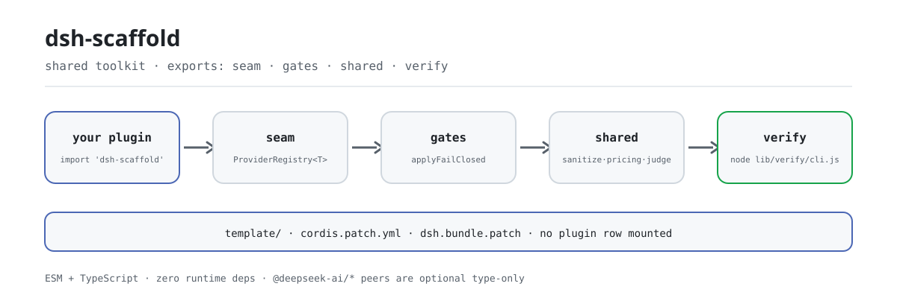

<div align="center">

<picture>
  <source media="(prefers-color-scheme: dark)" srcset="docs/assets/dsh-scaffold-flow-dark.svg">
  
</picture>

# dsh-scaffold

**把每个 DSH 插件都在重写的 Provider seam、审批门和 sanitize/pricing/judge 收进一个零依赖包。**

面向 PerryLink DSH 插件仓库的共享工具包：可插拔 Provider seam、fail-closed 审批门与自适应会话事件门、机械校验脚本、共享纯函数模块，外加一份新插件骨架。

[安装](#三步上手) · [配置](#配置) · [FAQ](#faq) · [简体中文](README.md) · [English](README.en.md) · [Español](README.es.md) · [Português](README.pt.md) · [हिन्दी](README.hi.md)

[](LICENSE)
[](#兼容性)
[](https://www.npmjs.com/package/dsh-scaffold)
[](https://github.com/PerryLink/dsh-scaffold/actions/workflows/ci.yml)
[](#兼容性)

[](https://github.com/PerryLink/dsh-scaffold/stargazers)
[](https://www.npmjs.com/package/dsh-scaffold)
[](https://dshfind.com/plugins/PerryLink/dsh-scaffold?ref=badge)
[](https://securityscorecards.dev/viewer/?uri=github.com/PerryLink/dsh-scaffold)
[](https://dsh.market/)

```sh
dsh plugin --profile <name> add dsh-scaffold
```

</div>

<sub>社区工具，与 DeepSeek 官方无关。不是认证、安全审计或官方背书：`dsh.standards` 块是 `not-run` 占位，不是通过。唯一仓库：<https://github.com/PerryLink/dsh-scaffold>。</sub>

## 它是什么

逐项审计 20+ 个插件后发现：每个仓都在手写同一套 Provider seam，并把同样的 sanitize、pricing 与裁决（verdict）数据结构重抄一遍。`dsh-scaffold` 把这些抽成一个 **ESM + TypeScript、零运行时依赖** 的库——可插拔 Provider seam、fail-closed 审批门与自适应会话事件门、机械校验脚本、共享的 sanitize/pricing/judge 纯函数模块，外加一份新插件骨架。

它是库，不是插件：不挂插件行、不注册命令或工具、不自己发起 I/O，也没有浏览器半；被消费的只有 import。

> **命名与包名。** 本项目曾用名 `@perrylink/dsh-plugin-kit`，现名 **`dsh-scaffold`**，旧仓只作指针／备份。npm 发布名是 `dsh-scaffold`；裸名 `dsh-scaffold` 属于另一个无关项目——装它不会装到本包。

```text
消费插件 ──import──▶ seam · gates · shared · verify
                          │
                          └── template/ 骨架 + cordis.patch.yml（有意留空：不挂行）
```

## 三步上手

1. **安装**（按用途选一条）：

   ```sh
   # 库用法：npm 通道
   pnpm add dsh-scaffold

   # 库用法：git 通道（prepare 只用生产依赖构建 lib/）
   pnpm add github:PerryLink/dsh-scaffold

   # profile 通道：让 profile 走 harness bundle 通道挂载
   dsh plugin --profile web add dsh-scaffold
   dsh plugin --profile web add github:PerryLink/dsh-scaffold
   ```

2. **替换手写注册表**：

   ```ts
   import { ProviderRegistry } from 'dsh-scaffold/seam'

   const registry = new ProviderRegistry<Detector>({
     default: { name: 'regex', impl: new RegexDetector() },
   })
   ctx.effect(() => registry.register('ner', new NerDetector()))
   const active = registry.use('ner') ?? registry.use()
   ```

3. **跑一遍机械校验**（非零退出码即失败）：

   ```sh
   pnpm run build
   node lib/verify/cli.js all .
   ```

**卸载**：`pnpm remove dsh-scaffold`（或从 profile patch 里删掉该行）。不注册任何全局状态：卸载就是安装的精确逆操作。

## 核心能力

`dsh-scaffold` 把 DSH 插件仓库反复重写的那几层抽成纯函数与薄门，运行时既不 import 任何 `@deepseek-ai/*`，也不产生依赖：

- **Provider seam** —— `ProviderRegistry<T>`：具名注册、可撤销（注册即 Cordis effect）、重名响亮失败而不是静默覆盖。
- **fail-closed 审批门** —— `applyFailClosed`：审批永不默认放行，唯一放行路径是显式 `allow-once`；`deny` 映射 `rejected`。
- **自适应会话事件门** —— `maybeAppendSessionEvent` 只在宿主收录该事件类型或信封可盖章时追加；被拒的追加跳过，绝不重试到可能破坏 session resume 的程度。
- **共享纯函数模块** —— `shared` 里的 sanitize、pricing、judge 与 `dsh-mask`／`dsh-budget`／`dsh-auto-review` 同名同形，迁移是机械替换。
- **机械校验与骨架** —— `verify` 子路径带 `VerifyReport` 与非零退出 CLI；`template/` 是三角色的新插件骨架（Service Definition／Provider／Consumer）。

### 工具与表面

| 子路径 | 用途 |
|---|---|
| `seam` | `ProviderRegistry<T>`——可逆、重名响亮失败的具名 Provider 注册表。 |
| `gates` | `applyFailClosed`；`makeEventGate` / `maybeAppendSessionEvent` / `probeIgnorableAppend`。 |
| `shared` | `sanitize`（`Stripper`、`redactText`、`redactMapping`、`sanitizeText`、`sanitizeUrl`）、`pricing`（`BUILTIN_PRICES`、`estimateUsageCost`、`tokenCarbon`、`latencyStats`、`formatMoney`、`formatTokens`）、`judge`（`parseVerdict`、`VERDICT_SCHEMA`、`riskExceeds`）。 |
| `verify` | 机械 CI 门（`verify-license`、`verify-readme-languages`、`verify-seam`），返回 `VerifyReport` 且 CLI 以非零码失败：`node lib/verify/cli.js all .` |
| `template/` | 新插件骨架（`cordis.yml`、三角色插件、测试、README、`renovate.json5`）。 |
| 根 barrel | 重导出以上全部。 |

### 示例

以下为这个库的真实入口；装上之后调用其中一个即可。

**详细示例** —— 命令：

```sh
import { createStripper } from 'dsh-scaffold/shared'
createStripper().strip('call 13800138000 or email a@b.com')
```

输出：

```text
call <PHONE_1> or email <EMAIL_1>
```

*Observed from `README.md:153 (shared sanitize); src/shared/sanitize.ts:268; test/sanitize.test.ts:8-19`*

**失败分支** —— 输入：

```text
const r = new ProviderRegistry(); r.register('openai', impl); r.register('openai', impl)  // second call
```

输出：

```text
Error: Provider "openai" is already registered
```

*Observed from `plugins/dsh-scaffold/lib/seam/provider.js:55-58; plugins/dsh-scaffold/test/seam.test.ts:27-30; plugins/dsh-scaffold/README.md:164`*

**简短示例**：`applyFailClosed` · `parseVerdict`

## 配置

无运行时配置：门与辅助函数都是纯函数，没有 `Config` 字段，也没有可覆盖的默认值。唯一的配置面是随包发布的 bundle-patch 层 `cordis.patch.yml`——它是有意留空的数组，供 harness profile 组合，也是消费插件挂自己那一行的规范位置；本包不挂任何行。

常用键（消费插件在自己的 profile patch 行里使用）：

| 键 | 默认值 | 含义 |
|---|---|---|
| `insert` | `[]` | patch 层的行数组；本包有意留空，不挂任何插件行 |
| `id` | — | 消费插件行的标识（只出现在消费插件自己的 patch 里） |
| `name` | — | 消费插件行的包名 |
| `config` | `{}` | 消费插件行的配置对象 |
| `disabled` | `false` | 消费插件行的开关 |

<details>
<summary>完整表（6 个键）</summary>

| 键 | 默认值 | 含义 |
|---|---|---|
| `dsh.bundle.patch` | `./cordis.patch.yml` | package.json 里声明的 bundle 补丁层入口；harness bundle 通道据此识别本包 |
| `insert` | `[]` | patch 层的行数组；本包有意留空，不挂任何插件行 |
| `id` | — | 消费插件行的标识（只出现在消费插件自己的 patch 里） |
| `name` | — | 消费插件行的包名 |
| `config` | `{}` | 消费插件行的配置对象 |
| `disabled` | `false` | 消费插件行的开关 |

</details>

消费插件的 patch 行就是这个形态（`cordis.patch.yml` 的注释里逐键列出）：

```yaml
insert:
  - id: my-plugin
    name: my-plugin
    config: {}
    # disabled: false
```

## FAQ

<details>
<summary>它会把依赖塞进我的插件吗？</summary>

不会。`dependencies` 是空对象，运行时零依赖；`@deepseek-ai/cordis`、`@deepseek-ai/schemastery` 与各 `@deepseek-ai/dsh-*` 全部声明为**可选** peer（`peerDependenciesMeta` 逐项 `optional: true`），只用于类型互通，装不装由你的依赖树决定。`pnpm run verify:self-contained` 正是守这条线的门。

</details>

<details>
<summary>它是插件还是库？那为什么还能用 `dsh plugin add`？</summary>

是库。包带一层 `dsh.bundle.patch`（`cordis.patch.yml`），那是有意留空的数组：走 bundle 通道挂载时不会多出任何插件行，只是让这个包能随 profile 一起被解析；卸载即删除，不留全局状态。

</details>

<details>
<summary>宿主不认我追加的会话事件类型时，会静默丢审计吗？</summary>

会跳过追加，但不静默：`maybeAppendSessionEvent` 只在宿主收录该类型或信封可盖章时追加；被拒的追加直接跳过，绝不重试到可能破坏 session resume 的程度（fail closed）。`probeIgnorableAppend` 负责先探测，探测本身抛错也按 `false` 处理。

</details>

<details>
<summary>审批门会不会默认放行？</summary>

不会。默认 `rejected`，唯一放行路径是显式 `allow-once`；`deny` 映射 `rejected`，`'delegate'` 在裁决层没有等价物，按 `deny` 处理并在 `EffectiveDecision.policy` 里保留 `'delegate'`。

</details>

<details>
<summary>有浏览器半吗？能直接用在客户端吗？</summary>

没有浏览器 UI 半。纯核心（`seam`、`gates`、`shared`）是 browser-safe 的，但整个包是给其他插件的 Host（及可选 Client）半消费的库，不含任何界面。

</details>

## 安全边界

- `sanitize`／`redact*` 是**展示卫生**，不是安全边界：它们降低日志与结果中的泄露，但不做认证或授权。
- 审批门默认 fail closed（`rejected`）；唯一放行路径是显式 `allow-once` 选择。
- 宿主拒绝的会话事件追加会被跳过，绝不重试到可能破坏会话 resume 的程度。
- 漏洞请走 GitHub Security Advisories——见 `SECURITY.md`。

## 权限与数据

本包自身不做任何 I/O、网络访问或子进程启动。`Stripper` 的占位符→原文映射只存内存，`stats()`／`redactMapping()` 绝不输出明文；消费方若要把映射持久化，那个决定与随之而来的存储权限由消费方自己承担。

## 已知限制

- `Session.append` 第三参为 `SurfaceIntent` 的宿主（`0.1.2-rc.1`）会对 ignorable 信封探测抛 `validateNext`；门退化为跳过未知类型，即这类宿主上审计事件被丢弃（fail closed）而不是写入。
- `0.1.2-rc.1`（2026-09-02 已适配）：会话信封保留 ignorable 字段，但仅用于存量日志读取兼容——`Session.append` 仍无法盖章，门控行为不变。
- 本包无浏览器 UI 半：它是被其他插件 Host（及可选 Client）半消费的库。

## 与其他 DSH 插件的互操作性

本包是库而不是插件，所以它对其他插件的影响面是“零注册”——下面每条都能从包清单与本仓源码直接判定，无需实测：

- **不挂插件行。** `cordis.patch.yml` 是有意留空的数组：走 bundle 通道也不会多出任何插件行。
- **不提供服务键。** 没有 `ctx.provide()`，因此不存在服务键冲突。
- **不注册命令、工具、客户端 slot 或 `webServer` 前缀。** 这些表面完全由消费插件持有。
- **运行时不 import 宿主包。** `@deepseek-ai/*` 全是可选 peer，仅供类型互通。
- **无全局改写。** 不改原型、不改写 `process.env`、不替换全局 fetch dispatcher。
- **线级兼容。** 函数名与形状对齐 `dsh-mask`（sanitize）、`dsh-budget`（pricing）、`dsh-auto-review`（judge 与 `fallbackPolicy` 词汇），同一家族的插件共用一套调用习惯。

## 兼容性

| 维度 | 状态 |
|---|---|
| Harness | 运行时零 `@deepseek-ai/*` import；`@deepseek-ai/cordis`（`^4.0.6-alpha.2`）、`@deepseek-ai/schemastery`（`^3.18.6-alpha.2`）与各 `@deepseek-ai/dsh-*` 是**可选** peer，区间 `>=0.1.2-rc.1 <0.2.0 \|\| >=0.1.5-alpha.1 <0.2.0 \|\| >=0.1.6-0 <0.2.0 \|\| >=0.1.7-0 <0.2.0 \|\| >=0.2.0-0 <0.3.0 \|\| >=0.2.1-0 <0.3.0 \|\| >=0.2.2-0 <0.3.0`，仅用于类型互通。2026-09-11 对 `dsh-v0.1.7-alpha.1` master checkout 核验（全量门禁链 + profile 安装冒烟），2026-10-05 对 `dsh-v0.2.1-alpha.1` checkout 复核（同套核验）。 |
| Node | `^22.19.0 \|\| >=24.0.0`，仅 ESM |
| 平台 | 任何 DSH 可运行处（纯库，无浏览器半） |
| 模型 | 无关：本包不调用模型 |
| 线级兼容 | 函数名与形状对齐 `dsh-mask`（sanitize）、`dsh-budget`（pricing）、`dsh-auto-review`（judge 与 `fallbackPolicy` 词汇），迁移是机械替换 |

## 生态与质量

- [dshfind 插件页](https://dshfind.com/plugins/PerryLink/dsh-scaffold)（安装量与排名）
- [OpenSSF Scorecard 报告](https://securityscorecards.dev/viewer/?uri=github.com/PerryLink/dsh-scaffold)（由 [.github/workflows/scorecard.yml](.github/workflows/scorecard.yml) 驱动）
- [DSH Market](https://dsh.market/)（已上架）
- **1024 商店渠道**：先 `npm i -g dsh1024`，再 `dsh1024 plugin --profile web add dsh-scaffold`（计入 [deepseek1024.com](https://deepseek1024.com) 安装排行）
- [生态实测知识库](https://perrylink.github.io/dsh-plugin-guide/)：插件开发指南 · 选型实测数据 · 维护取舍判据

## 开发

```sh
pnpm install
pnpm run typecheck            # tsc --noEmit
pnpm run typecheck:ci         # CI 面：tsc -p tsconfig.ci.json --noEmit
pnpm run typecheck:checkout   # checkout 面：tsc -p tsconfig.checkout.json --noEmit
pnpm test                     # vitest 单测
pnpm run build                # 产出 lib/ 与声明（prepare 也会执行）
pnpm run verify:self-contained
pnpm run verify:artifacts
pnpm run check:readmes        # 五语 README 一致性
pnpm pack                     # 发布 tarball
```

配图由 [`scripts/gen-readme-assets.py`](scripts/gen-readme-assets.py) 程序化生成（手写 SVG，浅色/深色两版，可重复执行）；本仓没有 benchmark 数据，因此不画 evidence 图。

本仓库同时是整个生态的维护枢纽：`scripts/sync-peer-range.mjs` 一条命令重钉目标目录里所有仓的共享 peer 区间，`renovate/default.json5` 是各仓统一继承的 Renovate 预设，`.github/workflows/npm-publish.yml` 是可复用的 tag 触发发布工作流（只需一个 `NPM_TOKEN` secret），`data/repos.json` 是门户消费的生态注册表——生态规模以该文件为准，本 README 不复述数字。逐项说明见 [`docs/ecosystem-tooling.md`](docs/ecosystem-tooling.md)。

Topics：`dsh`, `dsh-plugin`, `deepseek-harness`, `deepseek`, `cordis`, `perrylink`, `provider`, `seam`, `approval`, `sanitize`, `pricing`, `judge`

## 家族与致谢

本项目是 [PerryLink](https://github.com/PerryLink) 维护的 DeepSeek Harness 插件家族成员（全部 Apache-2.0），也是这个家族的维护枢纽。如果这个工具帮到了你，**给个 star**——它不解锁任何功能，但会让下一个人更容易找到它。

- [@PerryLink](https://github.com/PerryLink) —— 创建者与维护者：Provider seam、审批门与会话事件门、sanitize/pricing/judge 纯函数模块、校验脚本、`template/` 骨架与五语文档。
- [dsh-mask](https://github.com/PerryLink/dsh-mask) · [dsh-budget](https://github.com/PerryLink/dsh-budget) · [dsh-auto-review](https://github.com/PerryLink/dsh-auto-review) —— 被抽取的原始实现，线级兼容以它们为准。

<details>
<summary>展开全部插件</summary>

| 插件 | 状态 |
|---|---|
| **[dsh-aqua-input-check](https://github.com/PerryLink/dsh-aqua-input-check)** |  |
| **[dsh-archive-check](https://github.com/PerryLink/dsh-archive-check)** |  |
| **[dsh-auto-review](https://github.com/PerryLink/dsh-auto-review)** |  |
| **[dsh-autotier](https://github.com/PerryLink/dsh-autotier)** | 🧊 已冻结 — 见仓库 README |
| **[dsh-bid-ca-precheck](https://github.com/PerryLink/dsh-bid-ca-precheck)** |  |
| **[dsh-bid-qual-check](https://github.com/PerryLink/dsh-bid-qual-check)** |  |
| **[dsh-cert-mcp](https://github.com/PerryLink/dsh-cert-mcp)** | 🧊 已冻结 — 见仓库 README |
| **[dsh-checkpoint-rewind](https://github.com/PerryLink/dsh-checkpoint-rewind)** |  |
| **[dsh-click](https://github.com/PerryLink/dsh-click)** |  |
| **[dsh-composer-history](https://github.com/PerryLink/dsh-composer-history)** |  |
| **[dsh-contract-stance](https://github.com/PerryLink/dsh-contract-stance)** |  |
| **[dsh-customs-doc-check](https://github.com/PerryLink/dsh-customs-doc-check)** |  |
| **[dsh-data-quality](https://github.com/PerryLink/dsh-data-quality)** | 🧊 已冻结 — 见仓库 README |
| **[dsh-demurrage-ledger](https://github.com/PerryLink/dsh-demurrage-ledger)** |  |
| **[dsh-doublecheck](https://github.com/PerryLink/dsh-doublecheck)** |  |
| **[dsh-drill-script-check](https://github.com/PerryLink/dsh-drill-script-check)** |  |
| **[dsh-eia-guide-check](https://github.com/PerryLink/dsh-eia-guide-check)** |  |
| **[dsh-emergency-plan](https://github.com/PerryLink/dsh-emergency-plan)** |  |
| **[dsh-essay-rubric-check](https://github.com/PerryLink/dsh-essay-rubric-check)** |  |
| **[dsh-evidence-check](https://github.com/PerryLink/dsh-evidence-check)** |  |
| **[dsh-export-ctl-check](https://github.com/PerryLink/dsh-export-ctl-check)** |  |
| **[dsh-fast](https://github.com/PerryLink/dsh-fast)** |  |
| **[dsh-fmea-table-check](https://github.com/PerryLink/dsh-fmea-table-check)** |  |
| **[dsh-forecast-penalty](https://github.com/PerryLink/dsh-forecast-penalty)** |  |
| **[dsh-fund-research](https://github.com/PerryLink/dsh-fund-research)** |  |
| **[dsh-github](https://github.com/PerryLink/dsh-github)** |  |
| **[dsh-gongwen-flow-check](https://github.com/PerryLink/dsh-gongwen-flow-check)** |  |
| **[dsh-gongwen-word-check](https://github.com/PerryLink/dsh-gongwen-word-check)** |  |
| **[dsh-guard-plan-qc](https://github.com/PerryLink/dsh-guard-plan-qc)** |  |
| **[dsh-hazchem-check](https://github.com/PerryLink/dsh-hazchem-check)** |  |
| **[dsh-hazplan-check](https://github.com/PerryLink/dsh-hazplan-check)** |  |
| **[dsh-hidden-risk-map](https://github.com/PerryLink/dsh-hidden-risk-map)** |  |
| **[dsh-hs-classify](https://github.com/PerryLink/dsh-hs-classify)** |  |
| **[dsh-icd-rule-check](https://github.com/PerryLink/dsh-icd-rule-check)** |  |
| **[dsh-industry-research](https://github.com/PerryLink/dsh-industry-research)** |  |
| **[dsh-lawcite-adapter](https://github.com/PerryLink/dsh-lawcite-adapter)** |  |
| **[dsh-laya](https://github.com/PerryLink/dsh-laya)** |  |
| **[dsh-lc-doc-check](https://github.com/PerryLink/dsh-lc-doc-check)** |  |
| **[dsh-learning-gap-check](https://github.com/PerryLink/dsh-learning-gap-check)** |  |
| **[dsh-library](https://github.com/PerryLink/dsh-library)** |  |
| **[dsh-local-ai](https://github.com/PerryLink/dsh-local-ai)** |  |
| **[dsh-lsp-actions](https://github.com/PerryLink/dsh-lsp-actions)** |  |
| **[dsh-mask](https://github.com/PerryLink/dsh-mask)** |  |
| **[dsh-mcp-panel](https://github.com/PerryLink/dsh-mcp-panel)** |  |
| **[dsh-medrec-qc](https://github.com/PerryLink/dsh-medrec-qc)** |  |
| **[dsh-memento](https://github.com/PerryLink/dsh-memento)** | 🧊 已冻结 — 见仓库 README |
| **[dsh-nsfc-form-check](https://github.com/PerryLink/dsh-nsfc-form-check)** |  |
| **[dsh-nurse-record-check](https://github.com/PerryLink/dsh-nurse-record-check)** |  |
| **[dsh-observe](https://github.com/PerryLink/dsh-observe)** |  |
| **[dsh-origin-rvc-check](https://github.com/PerryLink/dsh-origin-rvc-check)** |  |
| **[dsh-ota-review-check](https://github.com/PerryLink/dsh-ota-review-check)** |  |
| **[dsh-output-styles](https://github.com/PerryLink/dsh-output-styles)** |  |
| **[dsh-paper-doc-adapter](https://github.com/PerryLink/dsh-paper-doc-adapter)** |  |
| **[dsh-permission-rules](https://github.com/PerryLink/dsh-permission-rules)** |  |
| **[dsh-permit-report-check](https://github.com/PerryLink/dsh-permit-report-check)** |  |
| **[dsh-pipeline-check](https://github.com/PerryLink/dsh-pipeline-check)** |  |
| **[dsh-pleading-draft](https://github.com/PerryLink/dsh-pleading-draft)** |  |
| **[dsh-plugin-doctor](https://github.com/PerryLink/dsh-plugin-doctor)** | 🚫 已退役（仓库已归档） |
| **[dsh-plugin-guide](https://github.com/PerryLink/dsh-plugin-guide)** |  |
| **[dsh-scaffold](https://github.com/PerryLink/dsh-scaffold)** |  |
| **[dsh-plugin-upgrade](https://github.com/PerryLink/dsh-plugin-upgrade)** | 🚫 已退役（仓库已归档） |
| **[dsh-policy-brief-draft](https://github.com/PerryLink/dsh-policy-brief-draft)** |  |
| **[dsh-power-loss-split](https://github.com/PerryLink/dsh-power-loss-split)** |  |
| **[dsh-power-ticket-check](https://github.com/PerryLink/dsh-power-ticket-check)** |  |
| **[dsh-ppap-check](https://github.com/PerryLink/dsh-ppap-check)** |  |
| **[dsh-protest-deadline](https://github.com/PerryLink/dsh-protest-deadline)** |  |
| **[dsh-railway-window](https://github.com/PerryLink/dsh-railway-window)** |  |
| **[dsh-repair-order-qc](https://github.com/PerryLink/dsh-repair-order-qc)** |  |
| **[dsh-research-report](https://github.com/PerryLink/dsh-research-report)** |  |
| **[dsh-review-reply-check](https://github.com/PerryLink/dsh-review-reply-check)** |  |
| **[dsh-rulefile-check](https://github.com/PerryLink/dsh-rulefile-check)** |  |
| **[dsh-safety-brief-check](https://github.com/PerryLink/dsh-safety-brief-check)** |  |
| **[dsh-score](https://github.com/PerryLink/dsh-score)** | 🧊 已冻结 — 见仓库 README |
| **[dsh-session-sync](https://github.com/PerryLink/dsh-session-sync)** |  |
| **[dsh-site-log-check](https://github.com/PerryLink/dsh-site-log-check)** |  |
| **[dsh-skill-pack-security](https://github.com/PerryLink/dsh-skill-pack-security)** |  |
| **[dsh-soe-decision-check](https://github.com/PerryLink/dsh-soe-decision-check)** |  |
| **[dsh-soilwater-check](https://github.com/PerryLink/dsh-soilwater-check)** |  |
| **[dsh-sop-sync-check](https://github.com/PerryLink/dsh-sop-sync-check)** |  |
| **[dsh-spc-gbt-adapter](https://github.com/PerryLink/dsh-spc-gbt-adapter)** |  |
| **[dsh-talk](https://github.com/PerryLink/dsh-talk)** |  |
| **[dsh-tender-extract](https://github.com/PerryLink/dsh-tender-extract)** |  |
| **[dsh-tender-matrix](https://github.com/PerryLink/dsh-tender-matrix)** |  |
| **[dsh-test-drive](https://github.com/PerryLink/dsh-test-drive)** |  |
| **[dsh-ticktick](https://github.com/PerryLink/dsh-ticktick)** | 🚫 已退役（仓库已归档） |
| **[dsh-translate](https://github.com/PerryLink/dsh-translate)** |  |
| **[dsh-warranty-calc](https://github.com/PerryLink/dsh-warranty-calc)** |  |
| **[dsh-community-bench](https://github.com/PerryLink/dsh-community-bench)** | 🧊 已冻结 — 见仓库 README |
| **[dsh-budget](https://github.com/PerryLink/dsh-budget)** | 🧊 已冻结 — 见仓库 README |
| **[dsh-claude-move](https://github.com/PerryLink/dsh-claude-move)** | 🧊 已冻结 — 见仓库 README |
| **[dsh-defend](https://github.com/PerryLink/dsh-defend)** | 🧊 已冻结 — 见仓库 README |
| **[dsh-draw](https://github.com/PerryLink/dsh-draw)** | 🧊 已冻结 — 见仓库 README |
| **[dsh-reach](https://github.com/PerryLink/dsh-reach)** | 🧊 已冻结 — 见仓库 README |
| **[dsh-background-agents](https://github.com/PerryLink/dsh-background-agents)** | 🚫 已退役（仓库已归档） |
| **[dsh-session-pin](https://github.com/PerryLink/dsh-session-pin)** | 🚫 已退役（仓库已归档） |
| **[dsh-team-rooms](https://github.com/PerryLink/dsh-team-rooms)** | 🚫 已退役（仓库已归档） |

</details>

## License

[LICENSE](LICENSE)（Apache License 2.0）© 2026 dsh-scaffold contributors

<p align="center"><sub>Apache-2.0 · 社区工具，与 DeepSeek 无关。</sub></p>
