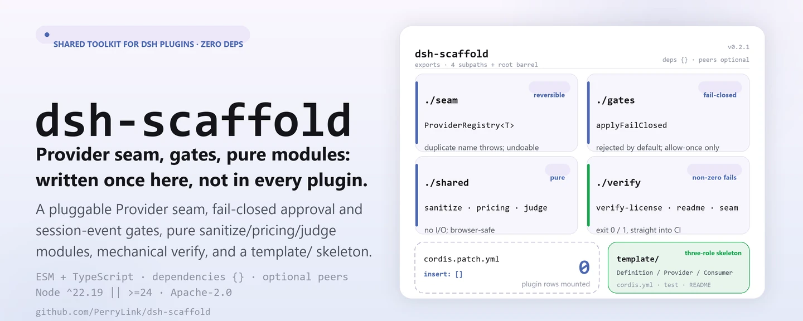
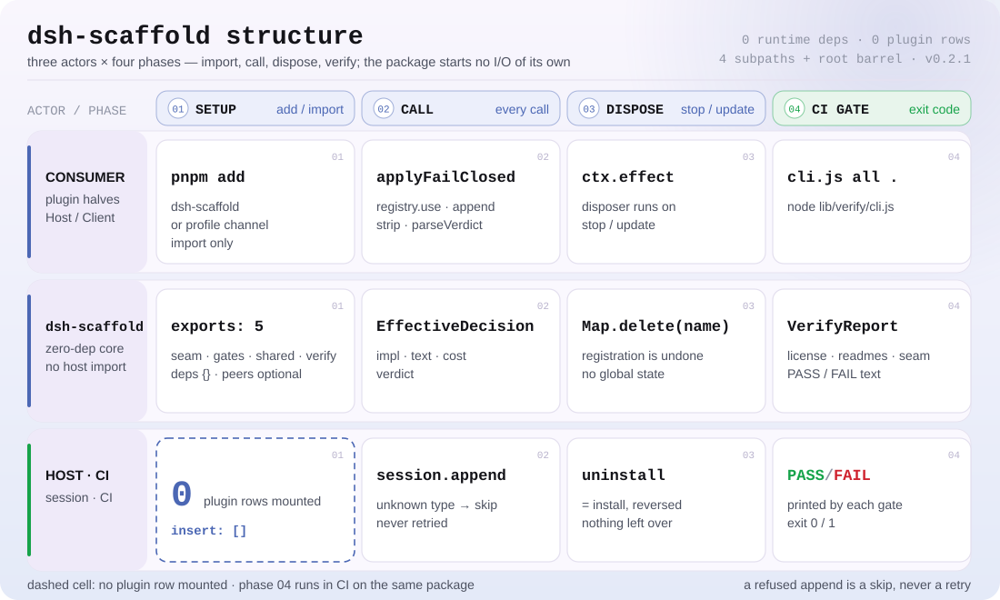

<div align="center">

<picture>
  <source media="(prefers-color-scheme: dark)" srcset="docs/assets/dsh-scaffold-hero-en-dark.webp">
  
</picture>

# dsh-scaffold

**Reunir num pacote sem dependências o seam Provider, a porta de aprovação e sanitize/pricing/judge que todo plugin DSH reescreve.**

Kit compartilhado para os repositórios de plugins DSH da PerryLink: seam Provider plugável, portas de aprovação fail-closed e de eventos de sessão adaptativas, scripts de verificação mecânica, módulos puros compartilhados e um esqueleto de plugin novo.

[Instalação](#instalação-em-três-passos) · [Configuração](#configuração) · [FAQ](#faq) · [简体中文](README.md) · [English](README.en.md) · [Español](README.es.md) · [Português](README.pt.md) · [हिन्दी](README.hi.md)

[](LICENSE)
[](#compatibilidade)
[](https://www.npmjs.com/package/dsh-scaffold)
[](https://github.com/PerryLink/dsh-scaffold/actions/workflows/ci.yml)
[](#compatibilidade)

[](https://github.com/PerryLink/dsh-scaffold/stargazers)
[](https://www.npmjs.com/package/dsh-scaffold)
[](https://dshfind.com/plugins/PerryLink/dsh-scaffold?ref=badge)
[](https://securityscorecards.dev/viewer/?uri=github.com/PerryLink/dsh-scaffold)
[](https://dsh.market/)

```sh
dsh plugin --profile <name> add dsh-scaffold
```

</div>

<sub>Ferramenta da comunidade, sem vínculo com a DeepSeek. Não é certificação, auditoria de segurança nem endosso oficial: o bloco `dsh.standards` é um marcador `not-run`, não uma aprovação. Repositório canônico: <https://github.com/PerryLink/dsh-scaffold>.</sub>

## O que é

Uma auditoria projeto a projeto de mais de 20 plugins mostrou que cada repositório escrevia à mão o mesmo seam Provider e recopiava as mesmas formas de sanitização, preços e veredictos. O `dsh-scaffold` extrai tudo isso numa única biblioteca **ESM + TypeScript, sem dependências em tempo de execução**: o seam Provider plugável, a porta de aprovação fail-closed e a porta adaptativa de eventos de sessão, os scripts de verificação mecânica, os módulos puros compartilhados sanitize/pricing/judge e um esqueleto de plugin novo.

É uma biblioteca, não um plugin: não monta nenhuma linha de plugin, não registra comando nem ferramenta, não inicia E/S própria e não tem metade de navegador; o que o consumidor importa é só um import.

> **Nome e nome do pacote.** Este projeto chamava-se `@perrylink/dsh-plugin-kit` e agora é **`dsh-scaffold`**; o repo antigo serve apenas como ponteiro/backup. O nome de publicação no npm é `dsh-scaffold`; o nome simples `dsh-scaffold` pertence a outro projeto não relacionado — instalá-lo não instala este pacote.

```text
plugin consumidor ──import──▶ seam · gates · shared · verify
                                     │
                                     └── esqueleto template/ + cordis.patch.yml (vazio de propósito: sem linhas)
```

<picture>
  <source media="(prefers-color-scheme: dark)" srcset="docs/assets/dsh-scaffold-flow-v5-dark.svg">
  
</picture>

## Instalação em três passos

1. **Instalar** (escolha a que serve):

   ```sh
   # uso como biblioteca: canal npm
   pnpm add dsh-scaffold

   # uso como biblioteca: canal git (prepare compila lib/ só com dependências de produção)
   pnpm add github:PerryLink/dsh-scaffold

   # canal de perfil: deixar um perfil montar pelo canal bundle do harness
   dsh plugin --profile web add dsh-scaffold
   dsh plugin --profile web add github:PerryLink/dsh-scaffold
   ```

2. **Substituir o registro escrito à mão**:

   ```ts
   import { ProviderRegistry } from 'dsh-scaffold/seam'

   const registry = new ProviderRegistry<Detector>({
     default: { name: 'regex', impl: new RegexDetector() },
   })
   ctx.effect(() => registry.register('ner', new NerDetector()))
   const active = registry.use('ner') ?? registry.use()
   ```

3. **Passar as portas mecânicas** (código de saída diferente de zero é falha):

   ```sh
   pnpm run build
   node lib/verify/cli.js all .
   ```

**Desinstalar**: `pnpm remove dsh-scaffold` (ou apagar a linha do patch do perfil). Nada registra estado global: desinstalar é exatamente o inverso de instalar.

## Capacidades principais

O `dsh-scaffold` transforma em funções puras e portas finas as camadas que todo repositório de plugins DSH reescreve; em tempo de execução não importa nada de `@deepseek-ai/*` e não adiciona dependências:

- **Seam Provider** — `ProviderRegistry<T>`: registro com nome, reversível (registrar é um efeito Cordis) e barulhento em nomes duplicados em vez de sobrescrever em silêncio.
- **Porta de aprovação fail-closed** — `applyFailClosed`: a aprovação nunca concede por padrão; o único caminho de concessão é um `allow-once` explícito, e `deny` mapeia para `rejected`.
- **Porta adaptativa de eventos de sessão** — `maybeAppendSessionEvent` só acrescenta quando o host registra o tipo do evento ou o envelope aceita selo; um append recusado é ignorado, jamais repetido de forma que possa quebrar a retomada de sessão.
- **Módulos puros compartilhados** — sanitize, pricing e judge em `shared` têm os mesmos nomes e formas que `dsh-mask` / `dsh-budget` / `dsh-auto-review`, então migrar é mecânico.
- **Portas mecânicas e esqueleto** — o subpath `verify` traz um `VerifyReport` e uma CLI com saída diferente de zero; `template/` é um esqueleto de três papéis (Service Definition / Provider / Consumer).

### Ferramentas e superfícies

| Subpath | Propósito |
|---|---|
| `seam` | `ProviderRegistry<T>` — registro de providers com nome, reversível e barulhento em duplicatas. |
| `gates` | `applyFailClosed`; `makeEventGate` / `maybeAppendSessionEvent` / `probeIgnorableAppend`. |
| `shared` | `sanitize` (`Stripper`, `redactText`, `redactMapping`, `sanitizeText`, `sanitizeUrl`), `pricing` (`BUILTIN_PRICES`, `estimateUsageCost`, `tokenCarbon`, `latencyStats`, `formatMoney`, `formatTokens`), `judge` (`parseVerdict`, `VERDICT_SCHEMA`, `riskExceeds`). |
| `verify` | Portas mecânicas de CI (`verify-license`, `verify-readme-languages`, `verify-seam`) que devolvem um `VerifyReport`, com CLI de saída diferente de zero: `node lib/verify/cli.js all .` |
| `template/` | Esqueleto de plugin novo (`cordis.yml`, plugin de três papéis, teste, README, `renovate.json5`). |
| barrel raiz | Reexporta tudo o que está acima. |

### Exemplos

Estes são os pontos de entrada reais da biblioteca; instale uma vez e chame um.

**Exemplo detalhado** — comando:

```sh
import { createStripper } from 'dsh-scaffold/shared'
createStripper().strip('call 13800138000 or email a@b.com')
```

Saída:

```text
call <PHONE_1> or email <EMAIL_1>
```

*Observed from `README.md:153 (shared sanitize); src/shared/sanitize.ts:268; test/sanitize.test.ts:8-19`*

**Ramo de falha** — entrada:

```text
const r = new ProviderRegistry(); r.register('openai', impl); r.register('openai', impl)  // second call
```

Saída:

```text
Error: Provider "openai" is already registered
```

*Observed from `plugins/dsh-scaffold/lib/seam/provider.js:55-58; plugins/dsh-scaffold/test/seam.test.ts:27-30; plugins/dsh-scaffold/README.md:164`*

**Exemplos curtos**: `applyFailClosed` · `parseVerdict`

## Configuração

Sem configuração em tempo de execução: as portas e os auxiliares são funções puras, sem campos `Config` nem padrões sobrescrevíveis. A única superfície de configuração é a camada de patch publicada como `cordis.patch.yml`: um array vazio de propósito para compor perfis do harness, e o lugar canônico onde os plugins consumidores acrescentam a própria linha. Este pacote não monta nenhuma linha.

Chaves mais usadas (o plugin consumidor as usa na própria linha do patch de perfil):

| Chave | Padrão | Significado |
|---|---|---|
| `insert` | `[]` | Array de linhas da camada de patch; aqui vazio de propósito: nenhuma linha é montada |
| `id` | — | Identificador da linha do plugin consumidor (aparece só no patch desse plugin) |
| `name` | — | Nome de pacote da linha do plugin consumidor |
| `config` | `{}` | Objeto de configuração da linha do plugin consumidor |
| `disabled` | `false` | Interruptor da linha do plugin consumidor |

<details>
<summary>Tabela completa (6 chaves)</summary>

| Chave | Padrão | Significado |
|---|---|---|
| `dsh.bundle.patch` | `./cordis.patch.yml` | Entrada da camada bundle-patch declarada no package.json; o canal bundle do harness a lê para reconhecer este pacote |
| `insert` | `[]` | Array de linhas da camada de patch; aqui vazio de propósito: nenhuma linha é montada |
| `id` | — | Identificador da linha do plugin consumidor (aparece só no patch desse plugin) |
| `name` | — | Nome de pacote da linha do plugin consumidor |
| `config` | `{}` | Objeto de configuração da linha do plugin consumidor |
| `disabled` | `false` | Interruptor da linha do plugin consumidor |

</details>

A linha de patch de um plugin consumidor tem exatamente esta forma (o `cordis.patch.yml` comenta cada chave):

```yaml
insert:
  - id: my-plugin
    name: my-plugin
    config: {}
    # disabled: false
```

## FAQ

<details>
<summary>Ele vai arrastar dependências para o meu plugin?</summary>

Não. `dependencies` é um objeto vazio, então não há dependências em tempo de execução; `@deepseek-ai/cordis`, `@deepseek-ai/schemastery` e os pacotes `@deepseek-ai/dsh-*` são peers **opcionais** (`peerDependenciesMeta` marca cada um com `optional: true`) e servem só para interoperar tipos: instalar ou não é decisão da sua árvore de dependências. `pnpm run verify:self-contained` é a porta que segura essa linha.

</details>

<details>
<summary>É um plugin ou uma biblioteca? E por que dá para instalar com `dsh plugin add`?</summary>

Uma biblioteca. O pacote traz uma camada `dsh.bundle.patch` (`cordis.patch.yml`) que é um array vazio de propósito: montá-lo pelo canal bundle não acrescenta nenhuma linha de plugin, apenas permite que este pacote resolva junto de um perfil; desinstalar remove, sem deixar estado global.

</details>

<details>
<summary>Se o host não registra meu tipo de evento de sessão, as auditorias somem em silêncio?</summary>

O append é ignorado, mas não em silêncio: `maybeAppendSessionEvent` só acrescenta quando o host registra o tipo ou o envelope aceita selo, e um append recusado é ignorado de imediato, jamais repetido de forma que possa quebrar a retomada de sessão (fail closed). `probeIgnorableAppend` sonda antes; uma sondagem que lança é tratada como `false`.

</details>

<details>
<summary>A porta de aprovação alguma vez concede por padrão?</summary>

Não. O padrão é `rejected`; o único caminho de concessão é um `allow-once` explícito. `deny` mapeia para `rejected`, e `'delegate'` não tem equivalente no veredicto, então resolve para `deny` enquanto `EffectiveDecision.policy` mantém `'delegate'`.

</details>

<details>
<summary>Existe metade de navegador? Posso usar direto num cliente?</summary>

Não existe metade de UI de navegador. O núcleo puro (`seam`, `gates`, `shared`) é browser-safe, mas o pacote inteiro é uma biblioteca consumida pelas metades Host (e opcionalmente Client) de outros plugins, e não inclui interface alguma.

</details>

## Limites de segurança

- `sanitize`/`redact*` são **higiene de apresentação**, não limite de segurança: reduzem vazamento para logs e resultados, mas não autenticam nem autorizam.
- As portas de aprovação falham fechadas por padrão (`rejected`); o único caminho de concessão é um `allow-once` explícito.
- Appends de eventos de sessão que o host recusa são ignorados, jamais repetidos de forma que possa quebrar a retomada de sessão.
- Relate vulnerabilidades pelo GitHub Security Advisories — veja `SECURITY.md`.

## Permissões e dados

O kit não faz nenhuma E/S, nenhum acesso à rede e nenhum spawn de subprocesso por conta própria. O `Stripper` mantém o mapeamento marcador→original só em memória, e `stats()`/`redactMapping()` nunca emitem texto puro; um consumidor que persista um mapeamento assume essa decisão e as permissões de armazenamento que ela traz.

## Limitações conhecidas

- Hosts cujo terceiro argumento de `Session.append` é um `SurfaceIntent` (`0.1.2-rc.1`) lançam `validateNext` na sondagem do envelope ignorable; a porta degrada para ignorar-o-desconhecido, então nesses hosts os eventos de auditoria são descartados (fail closed) em vez de registrados.
- `0.1.2-rc.1` (adaptado em 2026-09-02): o envelope de sessão mantém o campo ignorable só por compatibilidade de leitura de logs já gravados — `Session.append` continua sem poder selá-lo, então o comportamento da porta de auditoria não muda.
- O kit não inclui metade de UI de navegador; é uma biblioteca consumida pelas metades Host (e opcionalmente Client) de outros plugins.

## Interoperabilidade com outros plugins DSH

Este pacote é uma biblioteca, não um plugin, então sua pegada sobre outros plugins é "zero registro": cada ponto abaixo decorre direto do manifesto do pacote e das fontes deste repo, sem precisar sondar nada.

- **Nenhuma linha de plugin.** `cordis.patch.yml` é um array vazio de propósito: mesmo pelo canal bundle não aparece nenhuma linha de plugin.
- **Nenhuma chave de serviço.** Não há `ctx.provide()`, então nenhuma chave de serviço pode colidir.
- **Nenhum comando, ferramenta, slot de cliente ou prefixo `webServer`.** Essas superfícies ficam inteiramente com o plugin consumidor.
- **Nenhum import de host em tempo de execução.** Cada entrada `@deepseek-ai/*` é um peer opcional que serve só para tipos.
- **Nenhuma mutação global.** Não patch de protótipos, não reescreve `process.env`, não substitui o dispatcher global de fetch.
- **Compatibilidade de linha.** Nomes e formas espelham `dsh-mask` (sanitize), `dsh-budget` (pricing) e `dsh-auto-review` (judge e o vocabulário `fallbackPolicy`), então os plugins da família compartilham a mesma convenção de chamada.

## Compatibilidade

| Superfície | Estado |
|---|---|
| Harness | Zero imports de `@deepseek-ai/*` em tempo de execução; `@deepseek-ai/cordis` (`^4.0.6-alpha.2`), `@deepseek-ai/schemastery` (`^3.18.6-alpha.2`) e os pacotes `@deepseek-ai/dsh-*` são peers **opcionais** na faixa `>=0.1.2-rc.1 <0.2.0 \|\| >=0.1.5-alpha.1 <0.2.0 \|\| >=0.1.6-0 <0.2.0 \|\| >=0.1.7-0 <0.2.0 \|\| >=0.2.0-0 <0.3.0 \|\| >=0.2.1-0 <0.3.0 \|\| >=0.2.2-0 <0.3.0`, só para interoperar tipos. Verificado em 2026-09-11 contra o checkout master `dsh-v0.1.7-alpha.1` (cadeia completa de portas + smoke de instalação de perfil) e re-verificado em 2026-10-05 contra o checkout `dsh-v0.2.1-alpha.1` (mesmas verificações). |
| Node | `^22.19.0 \|\| >=24.0.0`, só ESM |
| Plataformas | Onde o DSH rodar (biblioteca pura, sem metade de navegador) |
| Modelo | Irrelevante: o kit não chama modelo algum |
| Compatibilidade de linha | Nomes e formas espelham `dsh-mask` (sanitize), `dsh-budget` (pricing) e `dsh-auto-review` (judge e o vocabulário `fallbackPolicy`), então migrar é mecânico |

## Ecossistema e qualidade

- [Página do dshfind](https://dshfind.com/plugins/PerryLink/dsh-scaffold) (instalações e ranking)
- [Relatório OpenSSF Scorecard](https://securityscorecards.dev/viewer/?uri=github.com/PerryLink/dsh-scaffold) (movido por [.github/workflows/scorecard.yml](.github/workflows/scorecard.yml))
- [DSH Market](https://dsh.market/) (listado)
- **Canal da loja 1024**: primeiro `npm i -g dsh1024`, depois `dsh1024 plugin --profile web add dsh-scaffold` (conta para o ranking de instalações do [deepseek1024.com](https://deepseek1024.com))
- [Base de conhecimento do ecossistema](https://perrylink.github.io/dsh-plugin-guide/): guia de desenvolvimento de plugins · dados de seleção · critérios de manutenção

## Desenvolvimento

```sh
pnpm install
pnpm run typecheck            # tsc --noEmit
pnpm run typecheck:ci         # face de CI: tsc -p tsconfig.ci.json --noEmit
pnpm run typecheck:checkout   # face de checkout: tsc -p tsconfig.checkout.json --noEmit
pnpm test                     # testes unitários com vitest
pnpm run build                # emite lib/ + declarações (prepare também executa)
pnpm run verify:self-contained
pnpm run verify:artifacts
pnpm run check:readmes        # consistência dos README em cinco idiomas
pnpm pack                     # o tarball publicado
```

As imagens do README são geradas programaticamente por [`scripts/gen-readme-assets.py`](scripts/gen-readme-assets.py) (SVG escrito à mão, variantes clara e escura, pode ser reexecutado); este repositório não traz dados de benchmark, então não há gráfico de evidência.

Este repositório também é o centro de manutenção do ecossistema: `scripts/sync-peer-range.mjs` re-fixa a faixa peer compartilhada em todos os repos do diretório alvo com um comando, `renovate/default.json5` é o preset de Renovate que todos os repos estendem, `.github/workflows/npm-publish.yml` é um workflow de publicação reutilizável disparado por tag (precisa só de um secret `NPM_TOKEN`) e `data/repos.json` é o registro do ecossistema consumido pelo portal — o registro é o número de referência e este README não repete seus números. Veja [`docs/ecosystem-tooling.md`](docs/ecosystem-tooling.md).

Topics: `dsh`, `dsh-plugin`, `deepseek-harness`, `deepseek`, `cordis`, `perrylink`, `provider`, `seam`, `approval`, `sanitize`, `pricing`, `judge`

## Família e agradecimentos

Este projeto faz parte da família de plugins DeepSeek Harness da [PerryLink](https://github.com/PerryLink) (todos Apache-2.0) e é o centro de manutenção dela. Se este kit ajuda você, **uma estrela ajuda a próxima pessoa a encontrá-lo** — não desbloqueia nada.

- [@PerryLink](https://github.com/PerryLink) — criador e mantenedor: o seam Provider, as portas de aprovação e de eventos de sessão, os módulos puros sanitize/pricing/judge, os scripts de verificação, o esqueleto `template/` e a documentação em cinco idiomas.
- [dsh-mask](https://github.com/PerryLink/dsh-mask) · [dsh-budget](https://github.com/PerryLink/dsh-budget) · [dsh-auto-review](https://github.com/PerryLink/dsh-auto-review) — as implementações originais das quais este kit foi extraído; elas definem a compatibilidade de linha.

<details>
<summary>Expandir todos os plugins</summary>

| Plugin | Status |
|---|---|
| **[dsh-aqua-input-check](https://github.com/PerryLink/dsh-aqua-input-check)** |  |
| **[dsh-archive-check](https://github.com/PerryLink/dsh-archive-check)** |  |
| **[dsh-auto-review](https://github.com/PerryLink/dsh-auto-review)** |  |
| **[dsh-autotier](https://github.com/PerryLink/dsh-autotier)** | 🧊 CONGELADO — ver o README do repo |
| **[dsh-bid-ca-precheck](https://github.com/PerryLink/dsh-bid-ca-precheck)** |  |
| **[dsh-bid-qual-check](https://github.com/PerryLink/dsh-bid-qual-check)** |  |
| **[dsh-cert-mcp](https://github.com/PerryLink/dsh-cert-mcp)** | 🧊 CONGELADO — ver o README do repo |
| **[dsh-checkpoint-rewind](https://github.com/PerryLink/dsh-checkpoint-rewind)** |  |
| **[dsh-click](https://github.com/PerryLink/dsh-click)** |  |
| **[dsh-composer-history](https://github.com/PerryLink/dsh-composer-history)** |  |
| **[dsh-contract-stance](https://github.com/PerryLink/dsh-contract-stance)** |  |
| **[dsh-customs-doc-check](https://github.com/PerryLink/dsh-customs-doc-check)** |  |
| **[dsh-data-quality](https://github.com/PerryLink/dsh-data-quality)** | 🧊 CONGELADO — ver o README do repo |
| **[dsh-demurrage-ledger](https://github.com/PerryLink/dsh-demurrage-ledger)** |  |
| **[dsh-doublecheck](https://github.com/PerryLink/dsh-doublecheck)** |  |
| **[dsh-drill-script-check](https://github.com/PerryLink/dsh-drill-script-check)** |  |
| **[dsh-eia-guide-check](https://github.com/PerryLink/dsh-eia-guide-check)** |  |
| **[dsh-emergency-plan](https://github.com/PerryLink/dsh-emergency-plan)** |  |
| **[dsh-essay-rubric-check](https://github.com/PerryLink/dsh-essay-rubric-check)** |  |
| **[dsh-evidence-check](https://github.com/PerryLink/dsh-evidence-check)** |  |
| **[dsh-export-ctl-check](https://github.com/PerryLink/dsh-export-ctl-check)** |  |
| **[dsh-fast](https://github.com/PerryLink/dsh-fast)** |  |
| **[dsh-fmea-table-check](https://github.com/PerryLink/dsh-fmea-table-check)** |  |
| **[dsh-forecast-penalty](https://github.com/PerryLink/dsh-forecast-penalty)** |  |
| **[dsh-fund-research](https://github.com/PerryLink/dsh-fund-research)** |  |
| **[dsh-github](https://github.com/PerryLink/dsh-github)** |  |
| **[dsh-gongwen-flow-check](https://github.com/PerryLink/dsh-gongwen-flow-check)** |  |
| **[dsh-gongwen-word-check](https://github.com/PerryLink/dsh-gongwen-word-check)** |  |
| **[dsh-guard-plan-qc](https://github.com/PerryLink/dsh-guard-plan-qc)** |  |
| **[dsh-hazchem-check](https://github.com/PerryLink/dsh-hazchem-check)** |  |
| **[dsh-hazplan-check](https://github.com/PerryLink/dsh-hazplan-check)** |  |
| **[dsh-hidden-risk-map](https://github.com/PerryLink/dsh-hidden-risk-map)** |  |
| **[dsh-hs-classify](https://github.com/PerryLink/dsh-hs-classify)** |  |
| **[dsh-icd-rule-check](https://github.com/PerryLink/dsh-icd-rule-check)** |  |
| **[dsh-industry-research](https://github.com/PerryLink/dsh-industry-research)** |  |
| **[dsh-lawcite-adapter](https://github.com/PerryLink/dsh-lawcite-adapter)** |  |
| **[dsh-laya](https://github.com/PerryLink/dsh-laya)** |  |
| **[dsh-lc-doc-check](https://github.com/PerryLink/dsh-lc-doc-check)** |  |
| **[dsh-learning-gap-check](https://github.com/PerryLink/dsh-learning-gap-check)** |  |
| **[dsh-library](https://github.com/PerryLink/dsh-library)** |  |
| **[dsh-local-ai](https://github.com/PerryLink/dsh-local-ai)** |  |
| **[dsh-lsp-actions](https://github.com/PerryLink/dsh-lsp-actions)** |  |
| **[dsh-mask](https://github.com/PerryLink/dsh-mask)** |  |
| **[dsh-mcp-panel](https://github.com/PerryLink/dsh-mcp-panel)** |  |
| **[dsh-medrec-qc](https://github.com/PerryLink/dsh-medrec-qc)** |  |
| **[dsh-memento](https://github.com/PerryLink/dsh-memento)** | 🧊 CONGELADO — ver o README do repo |
| **[dsh-nsfc-form-check](https://github.com/PerryLink/dsh-nsfc-form-check)** |  |
| **[dsh-nurse-record-check](https://github.com/PerryLink/dsh-nurse-record-check)** |  |
| **[dsh-observe](https://github.com/PerryLink/dsh-observe)** |  |
| **[dsh-origin-rvc-check](https://github.com/PerryLink/dsh-origin-rvc-check)** |  |
| **[dsh-ota-review-check](https://github.com/PerryLink/dsh-ota-review-check)** |  |
| **[dsh-output-styles](https://github.com/PerryLink/dsh-output-styles)** |  |
| **[dsh-paper-doc-adapter](https://github.com/PerryLink/dsh-paper-doc-adapter)** |  |
| **[dsh-permission-rules](https://github.com/PerryLink/dsh-permission-rules)** |  |
| **[dsh-permit-report-check](https://github.com/PerryLink/dsh-permit-report-check)** |  |
| **[dsh-pipeline-check](https://github.com/PerryLink/dsh-pipeline-check)** |  |
| **[dsh-pleading-draft](https://github.com/PerryLink/dsh-pleading-draft)** |  |
| **[dsh-plugin-doctor](https://github.com/PerryLink/dsh-plugin-doctor)** | 🚫 APOSENTADO (repo arquivado) |
| **[dsh-plugin-guide](https://github.com/PerryLink/dsh-plugin-guide)** |  |
| **[dsh-scaffold](https://github.com/PerryLink/dsh-scaffold)** |  |
| **[dsh-plugin-upgrade](https://github.com/PerryLink/dsh-plugin-upgrade)** | 🚫 APOSENTADO (repo arquivado) |
| **[dsh-policy-brief-draft](https://github.com/PerryLink/dsh-policy-brief-draft)** |  |
| **[dsh-power-loss-split](https://github.com/PerryLink/dsh-power-loss-split)** |  |
| **[dsh-power-ticket-check](https://github.com/PerryLink/dsh-power-ticket-check)** |  |
| **[dsh-ppap-check](https://github.com/PerryLink/dsh-ppap-check)** |  |
| **[dsh-protest-deadline](https://github.com/PerryLink/dsh-protest-deadline)** |  |
| **[dsh-railway-window](https://github.com/PerryLink/dsh-railway-window)** |  |
| **[dsh-repair-order-qc](https://github.com/PerryLink/dsh-repair-order-qc)** |  |
| **[dsh-research-report](https://github.com/PerryLink/dsh-research-report)** |  |
| **[dsh-review-reply-check](https://github.com/PerryLink/dsh-review-reply-check)** |  |
| **[dsh-rulefile-check](https://github.com/PerryLink/dsh-rulefile-check)** |  |
| **[dsh-safety-brief-check](https://github.com/PerryLink/dsh-safety-brief-check)** |  |
| **[dsh-score](https://github.com/PerryLink/dsh-score)** | 🧊 CONGELADO — ver o README do repo |
| **[dsh-session-sync](https://github.com/PerryLink/dsh-session-sync)** |  |
| **[dsh-site-log-check](https://github.com/PerryLink/dsh-site-log-check)** |  |
| **[dsh-skill-pack-security](https://github.com/PerryLink/dsh-skill-pack-security)** |  |
| **[dsh-soe-decision-check](https://github.com/PerryLink/dsh-soe-decision-check)** |  |
| **[dsh-soilwater-check](https://github.com/PerryLink/dsh-soilwater-check)** |  |
| **[dsh-sop-sync-check](https://github.com/PerryLink/dsh-sop-sync-check)** |  |
| **[dsh-spc-gbt-adapter](https://github.com/PerryLink/dsh-spc-gbt-adapter)** |  |
| **[dsh-talk](https://github.com/PerryLink/dsh-talk)** |  |
| **[dsh-tender-extract](https://github.com/PerryLink/dsh-tender-extract)** |  |
| **[dsh-tender-matrix](https://github.com/PerryLink/dsh-tender-matrix)** |  |
| **[dsh-test-drive](https://github.com/PerryLink/dsh-test-drive)** |  |
| **[dsh-ticktick](https://github.com/PerryLink/dsh-ticktick)** | 🚫 APOSENTADO (repo arquivado) |
| **[dsh-translate](https://github.com/PerryLink/dsh-translate)** |  |
| **[dsh-warranty-calc](https://github.com/PerryLink/dsh-warranty-calc)** |  |
| **[dsh-community-bench](https://github.com/PerryLink/dsh-community-bench)** | 🧊 CONGELADO — ver o README do repo |
| **[dsh-budget](https://github.com/PerryLink/dsh-budget)** | 🧊 CONGELADO — ver o README do repo |
| **[dsh-claude-move](https://github.com/PerryLink/dsh-claude-move)** | 🧊 CONGELADO — ver o README do repo |
| **[dsh-defend](https://github.com/PerryLink/dsh-defend)** | 🧊 CONGELADO — ver o README do repo |
| **[dsh-draw](https://github.com/PerryLink/dsh-draw)** | 🧊 CONGELADO — ver o README do repo |
| **[dsh-reach](https://github.com/PerryLink/dsh-reach)** | 🧊 CONGELADO — ver o README do repo |
| **[dsh-background-agents](https://github.com/PerryLink/dsh-background-agents)** | 🚫 APOSENTADO (repo arquivado) |
| **[dsh-session-pin](https://github.com/PerryLink/dsh-session-pin)** | 🚫 APOSENTADO (repo arquivado) |
| **[dsh-team-rooms](https://github.com/PerryLink/dsh-team-rooms)** | 🚫 APOSENTADO (repo arquivado) |

</details>

## Licença

[LICENSE](LICENSE) (Apache License 2.0) © 2026 dsh-scaffold contributors

<p align="center"><sub>Apache-2.0 · Ferramenta da comunidade, sem vínculo com a DeepSeek.</sub></p>
